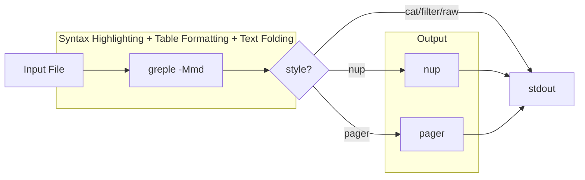

# App-mdee Project Instructions

## Overview

em·dee (mdee: Markdown, Easy on the Eyes) is a Markdown *text* viewer command implemented as a Bash script. It combines greple for syntax highlighting with nup for multi-column paged output.

**Concept:** mdee shows a `.md` file as it is written, made easier on the eyes with color; it is not a Markdown renderer and does not interpret or reformat the text. Table alignment, list-item folding, hiding markup characters (default themes), closing hashes on h3-h6 and, with `--refill`, joining the lines that a Markdown parser (CommonMark, Markdown::Perl or pandoc) finds to be one paragraph were added later for readability and are the only transformations. Keep new features within this idea: backslash escapes are shown as written, and `--no-theme` gives back the original text in color.

## Dependencies

| Tool | Package | Role |
|------|---------|------|
| greple | App::Greple | Regex-based syntax highlighting |
| ansifold | App::ansifold | ANSI-aware line folding (via md module) |
| ansicolumn | App::ansicolumn | Table column alignment (via md module) |
| nup | App::nup | Multi-column paged output |
| ansiecho | App::ansiecho | Color output utility |
| getoptlong.sh | Getopt::Long::Bash | Bash option parsing |
| termcolor | Getopt::EX::termcolor | Terminal luminance detection |
| - | Getopt::EX::Config | Module option handling |
| - | Command::Run | Function call wrapper for ansicolumn |

## Project Structure

- `script/mdee` - Main script (Bash) with POD documentation
- `lib/App/mdee.pm` - Perl module (version info only, generated from script/mdee)
- `lib/App/Greple/md.pm` - Greple module for Markdown syntax highlighting (bundled)
- `lib/App/Greple/md/Blocks.pm` - Paragraph positions for `refill`, from the CommonMark module, Markdown::Perl or pandoc
- `lib/App/Greple/md/widen.pm` - A function for `--begin`, a no-break space after characters that macOS terminals draw over two columns (`-t widen`)
- `t/00_compile.t` - Compile tests for both App::mdee and App::Greple::md
- `t/01_mdee.t` - mdee command integration tests
- `t/02_colorize.t` - md module colorize tests (uses t/runner)
- `t/03_nofork.t` - nofork vs fork table formatting tests
- `t/04_table_align.t` - Table alignment tests (parse_separator unit + integration)
- `t/05_table_wrap.t` - Table cell wrapping tests (sets `HOME` to an empty directory)
- `t/06_user_settings.t` - ansifold/ansicolumn rc files are not read when called from the md module
- `t/07_fold_runin.t` - fold_runin/fold_runout reach ansifold (line width with and without run-in)
- `t/08_refill_join.t` - `refill_block` unit tests (joining rules; no pandoc needed)
- `t/09_refill.t` - `refill=1` through greple: joining, folding of the joined lines, tables above them, with each available parser (skipped without one)
- `t/12_widen.t` - `App::Greple::md::widen`, alone and through `--begin`
- `t/13_begin.t` - the `--begin` option of the md module
- `t/11_quote_fold.t` - long block quote lines are folded with the quote marker repeated on the continuation lines, with and without color
- `t/14_escape.t` - control characters and escape sequences of the file are removed, colors stay
- `t/15_front_matter.t` - front matter is shown as a code block (marks in place of colors), only at the top, not folded; `front_matter=0`
- `t/10_blocks.t` - `App::Greple::md::Blocks`: both parsers report the same paragraph lines (skipped without one)
- `t/Util.pm` - Test helper for greple-based tests
- `t/runner/` - Submodule (p5-script-runner) for finding greple path
- `t/test.md` - Test Markdown file

**Important:** Documentation (POD) must be written in `script/mdee`. At release time, `minil release` hooks append the POD from `script/mdee` to `lib/App/mdee.pm` (see `minil.toml`).

## Development

`./script/mdee` automatically adds `../lib` to `PERL5LIB` when `../lib/App/Greple` exists, so the local `lib/App/Greple/md.pm` is used during development without needing `cpanm .`.

### Testing Colors

```bash
./script/mdee t/test.md              # light mode (nup style)
./script/mdee --mode=dark t/test.md  # dark mode
./script/mdee -p t/test.md           # pager style
./script/mdee -f t/test.md           # filter style (stdout)
./script/mdee --list-themes          # show theme samples
```

### Theme System

Built-in themes are defined as Bash associative arrays:
- `theme_light` - Light mode theme (full definition, includes `[base]`)
- `theme_dark` - Dark mode theme (differences from light, includes `[base]`)

Dark theme inherits undefined keys from light immediately after declaration (before config.sh is sourced). This ensures that both arrays have all keys, so config.sh and theme files can safely use `+=` on any key.

#### Theme as Transformation

Themes are not independent definitions — they are **transformations applied to `theme_light`/`theme_dark` and optionally `md_config[]`**. Each theme file is a Bash script that modifies these arrays directly:

```bash
# share/theme/warm.sh — change base color
theme_light[base]='<Coral>=y25'
theme_dark[base]='<Coral>=y80'
```

```bash
# share/theme/hashed.sh — enable closing hashes on h3-h6 via md module config
md_config+=(hashed.h3=1 hashed.h4=1 hashed.h5=1 hashed.h6=1)
```

#### Chaining Themes

The `--theme` option is an array with a callback (`@!` type). The default is `(hashed nomark markcell doubleline)`, declared as a Bash array before `OPTS` (the OPTS default is empty; getoptlong.sh preserves pre-declared arrays). Themes support comma-separated values and repeated options. Themes accumulate (added to the default); use `--no-theme` to clear. Duplicate themes are removed by `uniq_array`. Themes are applied in order, each modifying `theme_light`/`theme_dark`:

```bash
mdee file.md                        # default: hashed + nomark + markcell + doubleline
mdee --theme=warm file.md           # the default themes + warm
mdee --no-theme file.md             # no theme (show all markup)
mdee --no-theme --theme=warm        # warm only (clear default first)
```

Processing flow:
1. Each theme file is sourced in order (modifies `theme_light`/`theme_dark` and/or `md_config[]`)
2. `load_theme "$mode"` copies the final result to `colors[]`
3. `expand_theme` expands `${base}` references

#### Theme File Locations

Search order for theme files:

1. User theme: `${XDG_CONFIG_HOME:-$HOME/.config}/mdee/theme/NAME.sh`
2. Share theme: `$share_dir/theme/NAME.sh` (installed via distribution or `../share` in development)

The `find_share_dir()` function discovers the installed share directory via `@INC`, with a development fallback to `$0/../share`.

#### User Configuration as Theme

Config.sh and theme files can also modify colors and md module config:

```bash
# config.sh or theme file: change base color
theme_light[base]='<DarkCyan>=y25'
theme_dark[base]='<DarkCyan>=y80'

# config.sh or theme file: enable hashed headings via md module config
md_config+=(hashed.h3=1 hashed.h4=1 hashed.h5=1 hashed.h6=1)
```

#### Theme Listing

- `--list-themes`: Shows preview samples for all available themes. Field names are theme keys excluding `base`.
- Color specs use [Term::ANSIColor::Concise](https://metacpan.org/pod/Term::ANSIColor::Concise): `L00`-`L25` (gray scale), `${base}` (placeholder), `+l10`/`-l10` (lightness adjust), `D`/`I`/`U`/`E` (bold/italic/underline/erase), `FG/BG`.

### User Configuration

Config file: `${XDG_CONFIG_HOME:-~/.config}/mdee/config.sh`

The config file is sourced at global scope (not inside a function), so `declare -A` creates global variables. This allows custom themes to be defined in config.sh.

The `default` associative array supports:

| Key | Option | Example |
|-----|--------|---------|
| `default[mode]` | `--mode` | `dark` |
| `default[theme]` | `--theme` | `custom` |
| `default[style]` | `--style` | `pager` |
| `default[width]` | `--width` | `170` |
| `default[fold_width]` | `--fold-width` | `80` |
| `default[base_color]` | `--base-color` | `DarkCyan` |

Priority: command-line option > config default > built-in default.

`md_config`/`pass_md` entries added by config.sh are set aside while it is sourced and appended again after the theme files, so a user setting such as `md_config+=(table_cell_mark=∙)` overrides the default themes (`markcell`, `nomark`). Order of application: themes → config.sh entries → `--config`.

Config defaults for `default[theme]` are applied only when `--theme`/`--no-theme` is not specified on the command line. A `theme()` callback sets `_theme_specified` flag to track this.

The `--base-color` option default is empty (no override). Base color is determined by:
1. `--base-color` option (highest priority)
2. `default[base_color]` in config.sh
3. Theme's `[base]` key (e.g., `<RoyalBlue>=y25` for light)

### The `--config` Option

The `--config` option sets config parameters via `Getopt::EX::Config`. It uses `%!` (hash with callback) to preserve spaces in values, accumulating entries in `_config[]`.

Routing logic:
- Keys existing in `theme_light` (`base`, `FILE`, `FILE_FORMAT`) → consumed by bash, applied to both theme arrays
- Everything else → appended to `md_config[]`, forwarded to md module as config params

```bash
for _entry in "${_config[@]}"; do
    _key=${_entry%%=*} _val=${_entry#*=}
    if [[ -v theme_light[$_key] ]]; then
        theme_light[$_key]="$_val"
        theme_dark[$_key]="$_val"
    else
        md_config+=("$_entry")
    fi
done
```

Color labels (h1, bold, etc.) go to md_config and are handled by the md module's `Getopt::EX::Config` (pre-declared with `undef` default). Priority: default colors → config params → `--cm`.

Note: `--cm` is passed to the md module (before `--` in greple invocation), so it only works for md module labels (lowercase: `h1`, `bold`, etc.). Theme keys `FILE`/`FILE_FORMAT` are passed to greple's own `--cm` (after `--`), so they can only be set via `--config`, not `--cm`.

## Implementation Notes

### Pipeline Architecture

mdee constructs a pipeline dynamically:



Each stage is controlled by `--style` and individual `--[no-]fold`, `--[no-]table`, `--[no-]trim`, `--[no-]rule`, `--[no-]nup` options. Fold and table processing are handled within the greple `-Mmd` module (not as separate pipeline stages).

`--parallel` (`-V`) shows two or more files side by side: greple already separates files with `\f`, so `run_nup` invokes `nup -V --pane=$_cols - --pages` and ansicolumn lays the pages out as panes (one per file unless `--pane` is given; `_cols` is set to the file count so the fold width follows). With a single file the option is ignored.

`--[no-]filename` controls the file name label that greple prints at the top of each file (`--filestyle=once`, format and color from the `FILE_FORMAT`/`FILE` theme keys): `--no-filename` passes `-h` to greple so that panes start with the text. The label is only printed for more than one file anyway.

`--width` (`-w`) is the output width, as in ansicolumn: when given, it replaces `COLUMNS` in the pane-count and fold-width calculation (`_total`), and `run_nup`/`run_column` pass `--pane=$_cols` plus `-w N` after the file name `-` so nup agrees with mdee on the pane count. `--fold-width` sets the fold/table width directly (`fold_width`); its default is `_total / _cols - 3 - runin` with nup, or the output width without nup. Both have `default[...]` config keys. The 3 is for borders and padding; the run-in width is kept free by ansicolumn when it folds the panes. `--runin`/`--runout` (default 4, the ansifold default, so that Japanese text is folded well) and `--runlen` (`:!=i`, a callback that sets both, so the later option wins) are always given to nup in `pass_nup` (App::nup >= 1.09), which passes them to ansicolumn after `~/.ansicolumnrc`; otherwise a larger run-in in the rc file would make the outer fold break lines, such as table rules, that fill the fold width. `--boundary` (default `word`; `space` or `none`) is given to nup in `pass_nup` the same way (App::nup >= 1.10), because ansicolumn's `--document` only sets the boundary when it is not set and a `--boundary=none` in `~/.ansicolumnrc` would otherwise break paragraphs inside words while the md module folds lists at word boundaries. nup 1.10 counts only the arguments before the first option as files, so the `-w N` given after the file name `-` does not switch off page mode.

### Style System

The `--style` (`-s`) option controls which pipeline stages are active:

| Style | fold | table | rule | nup | pager | Use case |
|-------|------|-------|------|-----|-------|----------|
| `nup` (default) | on | on | on | on | - | Multi-column paged output |
| `pager` | on | on | on | - | on | Single-column with pager |
| `cat` | on | on | on | - | - | Output to stdout |
| `filter` | - | on | on | - | - | Piping / stdin |
| `raw` | - | - | - | - | - | Highlight only |

Shortcuts: `-f` = `--style=filter`, `-p` = `--style=pager`

```bash
mdee -s pager file.md       # fold + table, output to pager
mdee -f file.md             # table only (filter mode)
mdee -p file.md             # fold + table + pager
mdee -f --fold file.md      # filter + fold override
```

#### Implementation

Style defaults are applied after option parsing using a sentinel value:

```bash
[        style | s  :       # output style      ]=nup
[       filter | f   !      # filter mode       ]=
[        plain | p   !      # plain mode        ]=
[         fold |            # line folding      ]=_
[        table |            # table formatting  ]=_
[         trim |            # trim table cell spaces]=1
[          nup |            # use nup           ]=_
[         rule |            # table rule lines  ]=_
```

- `fold`/`table`/`nup`/`rule` default to sentinel `_` (not user-set)
- `trim` defaults to `1` (always on unless explicitly `--no-trim`), not style-dependent
- After getoptlong.sh, style defaults are applied only to sentinel values
- Explicit `--fold`/`--no-fold` sets the value to `1`/empty, overriding style
- `filter()` and `plain()` callbacks set `$style` during option parsing
- The `!` marker triggers the callback when option is parsed

```bash
filter() { style=filter; }
plain()  { [[ $plain ]] && style=pager || style=nup; }

# After getoptlong.sh:
case $style in
    nup)    style_defaults=([fold]=1 [table]=1 [nup]=1 [rule]=1) ;;
    pager)  style_defaults=([fold]=1 [table]=1 [nup]=  [rule]=1) ;;
    ...
esac
[[ $fold  == _ ]] && fold=${style_defaults[fold]}
[[ $table == _ ]] && table=${style_defaults[table]}
[[ $nup   == _ ]] && nup=${style_defaults[nup]}
[[ $rule  == _ ]] && rule=${style_defaults[rule]}
[[ ${rule:-} ]] && rule='│'
```

#### Pager Stage

When `style=pager`, the `run_pager` function is appended to the pipeline:

```bash
run_pager() { invoke ${PAGER:-less}; }

# Set defaults for less environment
export LESS="${LESS:--R}"
export LESSANSIENDCHARS="${LESSANSIENDCHARS:-mK}"

# Added to stages when style=pager:
[[ $style == pager ]] && stages+=(run_pager)
```

- `LESS=-R`: Required for ANSI color sequences (set when `LESS` is not defined)
- `LESSANSIENDCHARS=mK`: Recognize SGR (`m`) and erase line (`K`) sequences (set when not defined)
- These affect both direct pager mode and `nup` (which invokes `less` internally)
- User's existing environment settings are not overridden

#### Command Invocation Wrapper

All `run_XXX` functions use `invoke` to execute commands. When `debug > 1` (`-dd`), it prints the full command to stderr. In dryrun mode, `invoke` prints the command line to stdout instead of running it, and the dryrun block captures each stage's line and joins them with ` \` + newline + `    | `, so that `mdee -n` shows a pipeline that can be pasted into a shell. `quote_args` leaves an argument as it is when it consists of safe characters (`[-A-Za-z0-9_./:=,+%@]`) and wraps it in `'...'` otherwise (more readable than `printf %q`):

```bash
invoke() {
    (( debug > 1 )) && echo "debug: $(quote_args "$@")" >&2
    [[ ${dryrun:-} ]] && { quote_args "$@"; return; }
    "$@"
}
```

Debug levels:
- `-d` (`debug > 0`): `theme_light[]`/`theme_dark[]` values (sourceable format), pipeline stage names
- `-dd` (`debug > 1`): above + full command lines for each pipeline stage

Dryrun combinations:
- `-n`: print the command lines of the pipeline (stdout), without executing
- `-dn`: also the stage names (`debug: stages: run_greple run_nup`, stderr)
- `-ddn`: also each command line as `debug: ...` on stderr (the tests match these lines)

`-n` does not show the environment mdee sets (`LESS`, `LESSANSIENDCHARS`, and `PERL5LIB` when `./script/mdee` runs from the repository).

A stage in `stages[]` is either a `run_*` function, which calls `invoke` itself, or a command line written as shell words (`"sed -e 's/a/b/'"`).  Each stage is turned into a call in `calls[]`: a function is called as it is, and a command line becomes `invoke COMMAND LINE`, so it also stops in dryrun mode and shows up in `-dd`.  The real run `eval`s the calls joined with `|`; dryrun `eval`s them one by one in `$(...)` and joins their output, so both use the same calls.

In dryrun mode the stage functions really run, in a `$(...)` subshell each, up to their `invoke`, so what `-n` prints is the command the function builds, with all its branches.  A stage function must therefore not set variables that a later stage relies on: in dryrun mode the assignment stays in the subshell, and `-n` would show a pipeline different from the real one.  Prepare such values before the stages run, as `column_opts` is.

### App::Greple::md Module

Syntax highlighting, table formatting, and text folding are handled by the `App::Greple::md` Perl module. mdee invokes `greple -Mmd::config(mode,fold,fold_width,table,table_trim,rule,heading_markup,...) -- --filter --filestyle=once --color=always`.

- `-Mmd::config(...)`: Module config params (mode, fold, fold_width, table, table_trim, rule, heading_markup, hashed.*, color labels)
- `--show LABEL=VALUE`: Field visibility control; passed from `show[]` array
- `pass_md[]`: Passthrough options for md module (e.g., `--colormap` via `:>pass_md`)
- Options before `--` are module-specific; after `--` are greple options
- Fold controlled via `fold=1`; md module adds `--fold-by $fold_width $fold_runin $fold_runout` to its default option

### Protection Mechanism (protect/restore)

Early-processed regions (code blocks, inline code, comments, links) are replaced with ANSI-based placeholders `\e[256mN\e[m` to protect them from later patterns.

- Placeholder uses SGR 256 (impossible color, terminals ignore) + index into `@protected` array
- The `\e[m` reset at end enables **cumulative coloring**: when `apply_color` wraps placeholder with outer color (e.g., heading), it re-inserts the outer color after the reset
- Each step is a `Step` object: `Step(sub{})` (always active) or `Step(label => sub{})` (controllable via `--show`)
- Pipeline order determined by `build_pipeline()` based on `heading_markup`

#### Pipeline Architecture

Steps are organized into three groups:

```perl
my @protect_steps = qw(front_matter code_blocks comments image_links images links);
my @inline_steps  = qw(inline_code horizontal_rules bold_italic bold italic strike);
my @final_steps   = qw(blockquotes);
```

The `headings` step always calls `restore()` → color → `protect()`,
enabling cumulative coloring regardless of position. Its position
in the pipeline is controlled by `heading_markup`:

**`build_pipeline()` logic:**
- `heading_markup=0` (default): `@protect_steps`, **headings**, `@inline_steps`, `@final_steps`
- `heading_markup=1` or `all`: `@protect_steps`, `@inline_steps`, **headings**, `@final_steps`
- `heading_markup=bold:italic`: `@protect_steps`, bold, italic, **headings**, inline_code, horizontal_rules, strike, `@final_steps`

When `heading_markup` is a colon-separated step list, specified steps
are moved before headings while remaining inline steps stay after.
This allows selective markup inside headings (e.g., bold but not code).

Links are always processed before headings (in `@protect_steps`), so
OSC 8 hyperlinks in headings remain clickable regardless of
`heading_markup`.

The `colorize()` loop calls `$step->active` and `$step->run`:

```perl
for my $name (build_pipeline()) {
    my $step = $colorize{$name};
    $step->run if $step->active;
}
```

### Code & Emphasis Color Labels

Code-related and emphasis-related theme keys map directly to module labels:

| Theme Key | Module Label | Description |
|-----------|-------------|-------------|
| `code_mark` | `code_mark` | Fenced code block delimiters (```` ``` ````, `~~~`) |
| `code_tick` | `code_tick` | Inline code backticks (`` ` ``) |
| `code_info` | `code_info` | Fenced code block info string |
| `code_block` | `code_block` | Fenced code block body (with `;E`) |
| `code_inline` | `code_inline` | Inline code body (without `;E`) |
| `emphasis_mark` | `emphasis_mark` | Emphasis markers (`**`, `*`, `__`, `_`, `~~`) |
| - | `meta_mark` | Front matter delimiter lines (`L15/L10E` / `L10/L15E`) |
| - | `meta_block` | Front matter body (`L25/L12E` / `L00/L13E`) |

`emphasis_mark` is the default color for all emphasis markers. Per-type overrides
(`bold_mark`, `italic_mark`, `strike_mark`) can be defined via `--cm` and take
priority when present. This follows the same pattern as `code_tick` / `code_inline`.

```bash
# Light mode
[code_mark]='L20'
[code_tick]='L15/L23'
[code_info]='${base_name}=y70'
[code_block]='/L23;E'
[code_inline]='L00/L23'
[emphasis_mark]='L18'

# Dark mode
[code_mark]='L10'
[code_tick]='L15/L05'
[code_info]='L10'
[code_block]='/L05;E'
[code_inline]='L25/L05'
[emphasis_mark]='L10'
```

The `code_block` label includes `;E` (erase line) for full-width background on fenced code blocks. `code_tick` has background color matching `code_inline` for visual continuity, with dimmer foreground. `code_inline` has explicit foreground (`L00`/`L25`) to prevent heading foreground from bleeding through in cumulative coloring.

Inline code backticks are displayed as `` `content´ `` using `code_tick` color for the markers. Multi-backtick delimiters (``` `` ```, ```` ``` ````, etc.) are collapsed to a single pair, with optional surrounding spaces stripped per CommonMark. The open/close markers are configurable via `tick_open`/`tick_close` config parameters (default: `` ` `` / `´`).

Regex patterns used by the md module:

Fenced code blocks ([CommonMark](https://spec.commonmark.org/0.31.2/#fenced-code-blocks)):
```
^ {0,3}(?<bt>(?<fc>[`~])\g{fc}{2,}+)(.*)\n((?s:.*?))^ {0,3}\g{bt}\g{fc}*+\h*$
```

The closing fence is the same character as the opening one and at least as long, followed only by spaces or tabs; it is shown as written.  The `code_blocks` step uses the same rule with numbered captures.  A fence that is never closed is not treated as code (CommonMark would run it to the end of the document).

ATX headings ([CommonMark](https://spec.commonmark.org/0.31.2/#atx-headings)), for each level `$hdr` from `######` down to `#`: `^( {0,3}$hdr(?:\h+.*)?)$`.  Up to 3 spaces of indentation are allowed, and a line of `#`s alone is an empty heading; `#foo` (no space) and seven `#`s are not headings.

Inline code ([CommonMark Code Spans](https://spec.commonmark.org/0.31.2/#code-spans)) uses the `$CODE` pattern, which matches both single and multi-backtick spans. For multi-backtick (2+), optional leading/trailing spaces are stripped per CommonMark spec.

### Front Matter

Front matter at the top of the file (`front_matter()`: TOML between `+++` lines, YAML from `---` to `---` or `...`, not with a blank line right after the opening `---`, as pandoc defines it) is shown as a fenced code block: the first step, `front_matter`, colors the body with `meta_block` and the delimiter lines with `meta_mark` alone, as a fenced code block does, so that each can have its own background; by default the delimiter lines have the background of the file name label (`FILE`) and the body one a little apart, so that the front matter is striped; set to empty, `meta_block` falls back to `code_block` (`fallback_color()`, as `bold_mark` falls back to `emphasis_mark`), and without `meta_mark` (`defined_color()`) a delimiter line is `code_mark` inside the `meta_block` color, so that the background runs over the whole block, unlike a fenced code block; they are named `meta_*` because `front_matter` is the config switch and color labels share the config namespace, and protects the whole, so that no other markup applies (a `---` would otherwise be a rule, a `# comment` a heading). It is excluded from folding by `--exclude &__PACKAGE__::front_matter_region`, which finds the region by the line count `$front_lines` that `begin()` sets, because the text is colored by then, and refill leaves it alone. Front matter is not in CommonMark or GFM (checked 2026-11-09); config `front_matter=0` takes the lines as Markdown.

### Control Characters in the File

`begin()` first calls `remove_controls`, so that a Markdown file from someone else cannot send anything but colors to the terminal: OSC (title, clipboard, hyperlink), DCS, CSI other than SGR, other escape sequences, C0 controls except `\t \n \f \r`, DEL and C1. OSC and CSI use `$osc_re` and `$csi_re` of Text::ANSI::Fold, which also take the 8-bit forms; `$STRING` has the same form for DCS, SOS, PM and APC. ECMA-48 ends these with ST only; BEL is taken too, as in `$osc_re`, because terminals use it. A string sequence without a terminator, or with a control character that a command string cannot have, loses only its introducer, and its text stays. SGR stays, because a colored file is a reasonable input, except `\e[256m`, the mark of `protect()`: `\e[256mN\e[m` in a file would bring back protected text or die in `restore()`. The file name label is printed by greple and is not covered. Theme names with `/` are rejected by `load_theme_file`, so that `--theme` cannot run a file outside the theme directories.

### The `--begin` Option of the md Module

`--begin FUNCTION` before `--` is an option of the md module (`deal_with`, `@opt_begin`), like `--cm`: `begin()` calls each function first, with the text in `$_`, before `refill`, `colorize` and `format_table`. The `--begin` of greple after `--` is too late, because the module's own `--begin` from its default option comes first and `-M` must be at the beginning of the arguments. Functions are parsed once with `parse_func` of Getopt::EX::Func (a public API), `PACKAGE => 'main'` as in greple; a `sub{...}` is allowed. `resolve_function` finds the function and requires its package when it is not defined yet (a function defined by a module given with `-M` is used as it is), so a function in a module of its own needs no `-M`, which would have to come ahead of `-Mmd`. A name without a package is looked for in `main`, as in greple, and then as `App::Greple::md::name::name`. A function or a package that is not found is only warned about and skipped, while a module that exists and does not compile still dies. An extension that needs Perl code is therefore `lib/App/Greple/md/name.pm` with a function `name` and a theme with one line, `--begin '&name'`, not a part of `md.pm`. Perl's `AUTOLOAD` was tried for this and not used: it hides the check that the function exists, and a mistyped call inside `md.pm` would end up in it. In config.sh or a theme: `pass_md+=(--begin 'sub{ ... }')`.

### The `widen` Function (experimental)

`App::Greple::md::widen::widen` is a function for `--begin` (`-t widen`; `chars=2460-24FF:3248-324F` as a parameter). The theme lists the characters in the array `widen_chars` (with `+=`, one entry per line with a comment) and passes them as `chars`, so that config.sh, which is sourced before the themes, can add more with `widen_chars+=(...)`; the list depends on the terminal and its font, not on the code. The default of `chars` in the module (`2460-24FF:1F5D1`) is for greple without mdee. Circled digits (U+2460-U+24FF) have East Asian Width Ambiguous: one column to the tools and to the terminal, while macOS terminals (iTerm2 and Terminal) draw them over two, on top of the next character. The default `chars` is `2460-24FF:1F5D1`: the wastebasket 🗑 (U+1F5D1) has East Asian Width N and no Emoji_Presentation, so it is one column too, and is drawn as a two-column emoji. Menlo has no such glyphs, so a font fallback is the likely reason. Setting the terminal to treat Ambiguous as wide is no answer, because the box-drawing characters of the tables are Ambiguous too. The function adds U+00A0 after each character (after a variation selector U+FE0E or U+FE0F that follows it, possessively, so that the space does not cut the selector off the character), so that every tool counts two columns: a no-break space because `trim` of ansifold removes only ASCII spaces, so the column stays at the end of a folded line; at the end of a table cell it is removed by the cell separator pattern, and the padding of the cell takes its place. Fenced code with an info string, code spans, link destinations and autolinks are passed over by `(*SKIP)(*FAIL)`; fenced code without one is changed, because it is often a figure or an output (the README of OMC has such a figure), while a program must stay as written. It runs before `refill`, as all functions of `--begin` do.

### Text Folding (md module)

Text folding is handled within the `App::Greple::md` module using `-Mtee` to pipe matched regions through `ansifold`. The md module defines `--fold-by` as a greple option in its `__DATA__` section, and `--fold` is dynamically defined in `finalize()` via `$mod->setopt()` as a command option alias. The module option `--fold` enables folding via config.

#### Fold Architecture

- `fold` config parameter (default: 0) enables/disables folding
- `fold_width` config parameter (default: 80) controls the fold width
- `fold_runin`/`fold_runout` config parameters (default: 4, the ansifold default) are the run-in and run-out widths for the line breaking of folded lines; mdee passes its own `--runin`/`--runout` values (default 4 as well), so the folded lines run in by exactly the width that mdee keeps free in the pane and the outer fold (nup) never breaks them again
- `finalize()` defines `--fold` as `--fold-by $fold_width $fold_runin $fold_runout` via `$mod->setopt()` (for direct command-line use); `--fold-by` takes the three values as `$<shift>` arguments
- When `fold=1` in config, `finalize()` adds the same `--fold-by ...` to the module's default option
- mdee passes `fold=1,fold_width=$width` in config when fold is enabled
- The `--fold-by` option in `__DATA__` uses `-Mtee "&ansifold"` with `--exclude` patterns for code blocks, HTML comments, and tables. The lines it folds are `{LIST_ITEM}`, `{DEFINITION}`, `{QUOTE_LINE}` (a line starting with up to three spaces and one or more `>` markers, with the SGR sequences the `blockquotes` step puts around them) and, with `refill`, the joined paragraphs
- Formatted tables are excluded from folding by `--exclude &__PACKAGE__::table_regions`: `table_regions()` builds its pattern from the config at run time and matches three or more consecutive lines that start with a border/rule character, a dash, whitespace, or the first character of a configured mark (`table_wrap_mark`, `table_cell_mark`) and contain a column separator, where the block must include a separator row such as `───┼───`, so that list items containing `|` are not mistaken for a table. It works in trim and non-trim, rule and non-rule modes, including wrapped continuation lines. A `define` in `__DATA__` cannot depend on the config because option text is expanded when the module is parsed, before `finalize()` runs. Non-ASCII characters in `__DATA__` patterns must be written as `\x{2502}`-style escapes: the pattern text is not decoded, so literal box-drawing characters never match decoded input

#### Definition List Pattern

`(?:\A|\G\n|\n\n).+\n\n?(:\h+.*\n)`

- `(?:\A|\G\n|\n\n)`: Start of file, or after previous match, or after blank line
- `.+\n`: Term line
- `\n?`: Optional blank line between term and definition
- `(:\h+.*\n)`: Capture group for definition line (only this part is processed)

#### Table Formatting in md Module

Table formatting is handled within the `App::Greple::md` module's `begin()` function, which orchestrates `colorize()` (syntax highlighting) followed by `format_table()`:

```perl
sub begin {
    colorize()    if $config->{colorize};
    format_table() if $config->{table};
}
```

Stage execution is controlled by config flags: `colorize` (default: 1), `table` (default: 1). Fold is not controlled in `begin()` because it operates via greple's pattern matching pipeline (`-Mtee`), not text transformation in the `begin` hook.

`format_table()` detects table blocks via `(^ {0,3}\|.+\|\h*\n){3,}` (spaces after the last pipe are allowed, as in GFM, and removed from the block before formatting; a row with a trailing space used to split the table in two and stay as written) and processes each block:

```perl
s{(^ {0,3}\|.+\|\n){3,}}{
    my $block = $&;
    my($right, $center) = parse_separator(\$block);
    my @sep_opt;
    if ($config->{table_trim}) {
        @sep_opt = ('-rs', '\s*\|\s*', '--item-format= %s ', '--table-remove=1,-0', '--padding');
    } else {
        $_++ for @$right, @$center;
        @sep_opt = ('-s', '|');
    }
    my @align = (
        @$right  ? ('--table-right='  . join(',', @$right))  : (),
        @$center ? ('--table-center=' . join(',', @$center)) : (),
    );
    my @fit;   # -w table_width and/or --cell table_cell (see below)
    my $formatted = call_ansicolumn($block, @sep_opt, '-o', $sep, '-t', '--cu=1', @align, @fit);
    fix_separator($formatted, $sep);
}mge;
```

**Escaped pipes**: the split regex excludes a `|` preceded by a backslash (`(?<!\\)\|`, also in non-trim mode, which therefore uses `-rs` too), so `\|` stays inside its cell. It is displayed as written; backslash escapes in general (`\*`, `` \` ``, `\|` → `|`) are not processed by the md module yet.

**Trim mode** (`table_trim=1`, default): Strips cell whitespace with `-rs '\s*\|\s*'`, adds padding with `--item-format=' %s '`, removes the leading/trailing empty columns created by `|` delimiters with `--table-remove=1,-0`, and uses `--padding` to pad the last column to full width.

**Non-trim mode** (`table_trim=0`): Uses `-s '|'` as simple separator. Column numbers from `parse_separator` need `+1` offset because the leading `|` creates an empty column 1 in ansicolumn's split.

1. **Alignment parsing** — `parse_separator()` analyzes the separator line and returns raw column number arrays:

```perl
sub parse_separator {
    my $blockref = shift;
    my $SEP = qr/^\h*+\|(\h*+:?+-++:?+\h*+\|)++\h*+$/mn;
    my ($sep_line) = $$blockref =~ /($SEP)/;
    return ([], []) unless defined $sep_line;
    my @cells = split /\|/, $sep_line, -1;
    shift @cells; pop @cells;
    s/^\h+|\h+$//g for @cells;
    my @right  = grep { $cells[$_-1] =~ /^-+:$/  } 1..@cells;
    my @center = grep { $cells[$_-1] =~ /^:-+:$/ } 1..@cells;
    # Minimize dashes so separator width doesn't inflate column widths
    $$blockref =~ s{$SEP}{ ${^MATCH} =~ s/:?-+:?/-/gr }mpe;
    (\@right, \@center);
}
```

   - Finds separator line via `$SEP` pattern (each cell requires at least one `-`); all quantifiers are possessive, `/n` for non-capturing `()`
   - Splits cells with `split /\|/, $sep_line, -1` (the `-1` limit preserves trailing empty fields from the final `|`)
   - Detects `:---:` (center) and `---:` (right) patterns; `:---` and `---` are left-aligned (default, no option needed)
   - Returns raw 1-based column numbers as `(\@right, \@center)` — caller applies offset and builds option strings
   - Minimizes dashes and strips colons (`s/:?-+:?/-/gr`) to prevent separator width from inflating column widths
   - Requires App::ansicolumn >= 1.61 (1.55 for `--table-right`, `--table-center`, `--table-remove`, `--item-format`, `--padding`; 1.58 for `-w` table fitting and `--cell` in table mode; 1.5801 gives width that wrapped columns leave unused back to the other wrapped columns; 1.59 for `--table-wrap-mark` and `--table-cell-mark`; 1.60 for `--table-head` and cell marks limited to wrapped columns; 1.61 for its own rc file when called from greple, with Getopt::EX 3.04; the md module stops it from reading that rc file with Getopt::EX 3.05, see below)

**Cell wrapping** (`table_width`, `table_cell`): when `table_width > 0`, `-w $table_width` is appended and ansicolumn fits the table into that width. Columns that fit are untouched; over-wide columns share the remaining width equally (water level, floor 4) and their cells are wrapped by `Text::ANSI::Fold` (word boundary, kinsoku, run-in margin). In trim mode each column costs `content + 2` (item format) plus 1 per separator, so the budget is `table_width - (n-1)`. `table_cell` is converted from `0:10:<20` to `0,10,<20` and passed as `--cell`; in non-trim mode `0,` is prepended for the phantom first column. `table_wrap_mark` (default empty; the `markwrap` theme sets `›` U+203A) is passed as `--table-wrap-mark`; ansicolumn puts it at the start of the second and later lines of a wrapped cell in place of the item-format pad, so column widths do not change. Empty disables it. `table_cell_mark` (default empty; the default theme `markcell` sets `‣` U+2023) is passed as `--table-cell-mark` together with `--table-head 2` (App::ansicolumn >= 1.60): ansicolumn marks the first line of every non-empty body cell in the columns that have a wrapped cell, and leaves the two header rows (the header and, to ansicolumn, the separator row of `-` cells) alone, so `format_table` has nothing to undo before `fix_separator`.

2. **Column alignment** — `call_ansicolumn()` invokes `App::ansicolumn::ansicolumn()` via `Command::Run` (same pattern as the tee module's `call()` function):
   - `-rs '\s*\|\s*'` (trim) or `-s '|'` (non-trim): Input separator
   - `--item-format=' %s '` (trim only): Add padding to each cell
   - `--table-remove=1,-0` (trim only): Remove leading/trailing empty columns
   - `--padding` (trim only): Pad last column to full width
   - `-o $sep`: Output separator (`│` when rule is enabled, `|` otherwise)
   - `-t`: Table mode (auto-determine column widths)
   - `--cu=1`: Column unit (minimum column width)
   - `--table-right=N`: Right-align specified columns
   - `--table-center=N`: Center-align specified columns

3. **Separator fix** — `fix_separator()` converts separator lines to box-drawing characters, handling optional leading/trailing border separators:

```perl
sub fix_separator {
    my ($text, $sep) = @_;
    my $sep_re = $sep eq "\x{2502}" ? "\x{2502}" : '\\|';
    $text =~ s{^(\h*?)($sep_re)?((?:\h*-+\h*$sep_re)*\h*-+\h*)($sep_re)?(\h*?)$}{
        my($pre, $left, $mid, $right, $post) = ($1, $2, $3, $4, $5);
        if ($sep eq "\x{2502}") {
            ($pre  =~ tr[ ][\x{2500}]r)
            . (defined $left  ? "\x{251C}" : '')
            . ($mid =~ tr[\x{2502} -][\x{253C}\x{2500}\x{2500}]r)
            . (defined $right ? "\x{2524}" : '')
            . ($post =~ tr[ ][\x{2500}]r)
        } else { ... }
    }xmeg;
    $text;
}
```

   - Leading/trailing `$sep_re` are optional (`?`) — trim mode removes border columns, so separators may not have leading/trailing `│`
   - `$pre`/`$post` capture surrounding whitespace (from `--padding`), converted to `─` in rule mode
   - Rule mode: `│` → `┼`, spaces/dashes → `─`, borders `├`/`┤` only when present
   - Non-rule mode: spaces → `-`, borders `|` only when present

Config parameters from mdee:
- `fold=1`: Enable text folding (default disabled in md module)
- `fold_width=$width`: Fold width in columns
- `fold_runin=$runin`, `fold_runout=$runout`: Run-in and run-out widths for the folded lines, the same values mdee gives to nup (default 4, as in ansifold and in the md module)
- `table=1`: Enable table formatting (default enabled in md module)
- `table_trim=1`: Enable cell whitespace trimming (default enabled in md module)
- `rule=1`: Enable box-drawing characters (default enabled in md module)
- `table_style` (from `--table-style`, `--ts`; the default `lattice` is not passed, and mdee turns `pipe`, its older name, into `lattice`; the md module takes both): `lattice` has column separators. `3line` and `simple` have none: `format_table` formats the block as in rule mode, so that `fix_separator` puts `┼` at the column boundaries and the header rule stays per column, then blanks `│ ┼ ├ ┤` to spaces. `3line` adds a `─` rule of the table's visible width (`ansi_width` of the first line) above and below; `simple` adds a copy of the header rule below, as in `pandoc -t ansi`. With `rule=0` these rules are drawn with `-`. The name `grid` is left for a future style with an outer frame, as in Pandoc's grid tables.
- `table_width=$width`: Fit tables into the fold width (passed whenever fold is enabled); over-wide columns are wrapped by ansicolumn (`-w`). `0` disables.
- `table_cell=SPEC`: Per-column widths for ansicolumn `--cell`, colon-separated (`0:10:<20`) because commas separate config parameters; md module converts to commas and prepends `0,` in non-trim mode for the phantom first column. Not passed by mdee; set via `--config`.
- `table_wrap_mark=STRING`: Mark for continuation lines of wrapped cells (default none; the `markwrap` theme sets `›` U+203A).
- `table_cell_mark=STRING`: Mark for the first line of every body cell in a column that has a wrapped cell (default none; the default theme `markcell` sets `‣` U+2023). Passed with `--table-head 2` so the header and separator rows are not marked.
- `table_runin=2`, `table_runout=2`, `table_boundary=word`, `table_linebreak=all`: How wrapped cells are folded. Always passed to ansicolumn as `--runin`/`--runout`/`--boundary`/`--linebreak`, so the intent is visible in the command line. In table mode these options are used only for the cells. Kept apart from mdee's `--runin`/`--runout`, which are for nup's pane folding.
- **User rc files**: `finalize()` calls `no_user_settings(qw(ansicolumn ansifold))`, which adds the two names to `GETOPTEX_NO_USER_SETTINGS` (Getopt::EX >= 3.05; names already there are kept, `1`/`*` is left alone). Getopt::EX::Long then skips `~/.ansicolumnrc` and `~/.ansifoldrc` when the two are called as functions (Command::Run nofork) and, because the variable is inherited, also when the tee module runs ansifold in fork mode. nup runs in its own process from mdee, so the user's `~/.ansicolumnrc` still applies to the pane folding. `t/06_user_settings.t` checks this with rc files that would pad folded lines and mark table cells; `t/05_table_wrap.t` still sets `HOME` to an empty directory.
- Color labels (e.g., `h1=RD`): Override default colors (pre-declared in `Config->new()` with `undef`, applied in `setup_colors()` before `${base}` expansion)

### Paragraph Refill (md module)

`--refill` (`-r`; config `refill=1`; `default[refill]` in config.sh; off by default) joins the lines of each paragraph in the original text. mdee does not decide itself which lines form a paragraph: `refill()`, called first in `begin()`, asks `App::Greple::md::Blocks` (`blocks($text, parser => $config->{refill_parser})`) for the line ranges of the `Para` and `Plain` blocks. The module has three parsers: `cmark`, the CommonMark module (libcmark, in process, 0.001 s for README.md); `mdperl`, Markdown::Perl (pure Perl, a `requires` of this distribution, 0.03 s); and `pandoc` (`pandoc -f gfm+sourcepos+definition_lists -t json` via Command::Run, 0.5 s; `die "refill: pandoc failed"` when it fails). `available()` lists the ones that work in that order, and `blocks()` takes the first unless `parser` is given. mdee checks beforehand with `check_refill()`, which calls `available()`. cpanfile requires Markdown::Perl and only recommends CommonMark (it needs libcmark and a compiler); pandoc is not a Perl module. CI installs pandoc and libcmark-dev with apt, and cpanm installs the recommends, so all three run there.

- `cmark_blocks()` walks the CommonMark node tree and takes `get_start_line`/`get_end_line` of every paragraph node, with the block-quote depth. libcmark has no GFM tables and no definition lists, so it reports them as paragraphs; `refill_block` keeps their lines apart (table rows by their shape, a definition by its `: ` start).
- `mdperl_blocks()` has no public API to lean on: Markdown::Perl renders HTML only. Its block parser pushes each paragraph line in `_do_paragraph` and closes the paragraph in `_finalize_paragraph`, and keeps the offset of the current line in `last_pos`; the function wraps those two subs with `local *name` while it calls the private `_parse`, counts newlines up to `last_pos` for the line number (incrementally; the parser may step back a line, then it counts from the start), takes the quote depth from `blocks_stack`, and resets the paragraph start whenever the paragraph array was empty before the push (a setext heading takes the lines away without closing). `mdperl_works()` checks that the three private subs exist, so a Markdown::Perl release that renames them drops the parser from `available()` instead of breaking. Tables are parsed as paragraphs (`use_table_blocks => 0`) and YAML front matter as metadata, so the three parsers report the same lines; t/10 checks this.
- `pandoc_blocks()` collects every `data-pos`: pandoc wraps a block in a `Div` whose `data-pos` is `L:C-L:C` (several segments separated by `;` when it consumed markers, as for a list item's continuation lines; a table's segments are not in order), but a block with attributes of its own (`Header`, `CodeBlock`, `Table`, `Figure`) carries it in those attributes (`%attr_index`). An end column of 1 means the block ended on the line before. The end of a block is also cut at the line before the next block that starts below its first line, because a paragraph followed by a horizontal rule or a code fence without a blank line is reported up to that line. `depth` is the number of enclosing `BlockQuote`s.
- `refill()` takes the `Para`/`Plain` blocks from the bottom up (so the line numbers above stay valid) and replaces their lines with `refill_block(\@lines, $depth)`, which joins as ansifold's `fill_up` does (nothing after fullwidth punctuation or between two `InConcatScript` characters, one space otherwise; the properties are subs in App::ansifold, so the patterns are compiled at run time after `require`), strips `^\h*(?:>\h?){0,$depth}\h*` from the second line on, and keeps the break after a hard break (two spaces or an odd number of `\` at the end of a line; `\\` is an escaped backslash) and before a line that starts with a list marker (`#.` lists are paragraphs to pandoc), is a horizontal rule, looks like a table row (`format_table` takes three such lines as a table, although GFM reads them as paragraph text), or starts a footnote definition (`[^name]:`, also inside a quote; `cmark` and `mdperl` have no footnotes and report consecutive definitions as one paragraph).
- The final line numbers of the joined blocks go to `@refill_lines`. `format_table` records `[start line, lines added]` in `@table_shift`, because wrapped cells and `table_style=simple` change the line count (colorize keeps it); the shift is applied per line, since a range may contain a table (a paragraph line right above and below it). `refill_regions()` is a function pattern in `--fold-by` (`--cm N --le &__PACKAGE__::refill_regions`; `-E` would take `&name` as a regex; greple takes `&name` as a function only in a lexical expression, `--le`/`-x`) and returns one region per joined line, shifted by the tables above it. `{LIST_ITEM}` and `refill_regions` may return the same line; greple folds it once. Both arrays are reset in `begin()` for each file.
- `--autoindent` in `--fold-by` decides the prefix of the continuation lines, with `--keepindent=named` (App::ansifold 1.36): the quote markers are in the named group `(?<q>...)`, with the SGR sequences the `blockquotes` step puts around them, and are repeated on every continuation line; everything else in the match (indent, list marker, definition colon) becomes spaces of the same width, so `> - item` continues as `>   ...`, a list item as `  ...`, and a quoted paragraph keeps its `> `. The `blockquotes` step colors the markers only, not the indent before them, so that `^\h*` before the group matches the indent. The pattern is built in `__DATA__` from the defines `{SGR}` and `{LIST_MARKER}` as `{AUTOINDENT}` (a define is expanded inside the quoted tee argument too), and every part of it may be empty, so that every line matches and sets its own prefix: by design, ansifold keeps the prefix of the last matching line for the lines that do not match (its `ps axgw | ansifold --autoindent '.*TIME (?=COMMAND)'` example takes the indent from the header line for the whole table), which here would have indented a paragraph folded after a list item.
- `refill_block` keeps the break on both sides of a table-row line and treats a CR before the line break (CRLF file) as part of the line break. `refill()` leaves front matter at the top alone (config `front_matter`, default 1; `0` joins its lines as the parser reports them); the detection is `front_matter()`, and `begin()` keeps its line count in `$front_lines`, TOML (`+++` ... `+++`) and YAML (`---` ... `---` or `...`, not with a blank line right after the opening `---`, as in pandoc): pandoc's gfm reader takes TOML as a paragraph, and libcmark takes YAML as paragraphs and list items (the Qiita CLI front matter has a `tags:` list), while pandoc and Markdown::Perl take YAML as metadata. A block that starts inside the front matter is cut at its end, because libcmark runs a paragraph on past a closing `...`.
- When fold is off (filter, raw, `--no-fold`) a joined paragraph is one long line.
- Tests: `t/08_refill_join.t` (unit tests of `refill_block`, no parser needed), `t/10_blocks.t` (both parsers give the same lines on edge cases) and `t/09_refill.t` (greple runs, repeated for each parser that `available()` returns; `skip_all` without one). `t/01_mdee.t` checks the option with a `pandoc` stub that fails and a `CommonMark.pm` that dies, put ahead in PATH and PERL5LIB.

### Field Visibility with --show Option

The `--show` option controls field visibility using a hash type with callback:

```bash
declare -A show=()

declare -A OPTS=(
    [         show |   %!          # field visibility   ]=
)

show() {
    local arg=$2 key val
    if [[ $arg == *=* ]]; then
        key=${arg%%=*} val=${arg#*=}
    else
        key=$arg val=1
    fi
    if [[ $key == all ]]; then
        for k in "${show_fields[@]}"; do
            show[$k]=$val
        done
    fi
}
```

- `%!`: Hash type with callback
- Callback receives `($optname, $arg)` - parse key=value from `$arg`
- `all` is special: sets all fields to the given value
- Order matters: `--show all= --show bold` disables all, then enables bold
- Individual key=value is automatically handled by getoptlong.sh

In `run_greple()`, show values are passed to the md module:

```bash
for name in "${!show[@]}"; do
    [[ $name == all ]] && continue
    md_opts+=(--show "${name}=${show[$name]}")
done
```

The md module's `active()` function checks show flags and skips regex substitutions entirely for disabled fields.

### Emphasis Patterns (CommonMark)

Bold/italic/strike patterns use `$SKIP_CODE` as first alternative to skip code spans. Named captures `(?<m>...)` (markers) and `(?<t>...)` (content) with `\g{m}` backreference prevent mixing (`**...__`).

- `(?<![\\\w])` / `(?!\w)`: Word boundaries for `_`/`__` (prevents `foo_bar_baz`)
- `(?<!\*)` / `(?!\*)`: Distinguishes `*italic*` from `**bold**`
- `flanking($delim)`: returns the opener and closer patterns of `*` or `**`, left-flanking and right-flanking as in CommonMark (so `L*=50, a*=68` is not italic, while `2*3*4` is), or by the markdown-cjk-friendly rules with `cjk_friendly=1`; see "Flanking Rules and Japanese Text" under Limitations
- `mark_color($type, $text)`: Uses `${type}_mark` if in colormap, falls back to `emphasis_mark`
- `/p` flag with `${^MATCH}`: Safe alternative to `$&` (used by `$SKIP_CODE`)

### OSC 8 Hyperlinks

Links are converted to OSC 8 terminal hyperlinks. Three types (in processing order): `image_link` (`[](url)`), `image` (``), `link` (`[text](url)`). Each is colored, wrapped in OSC 8, and protected. Disable with `config(osc8=0)`.

URL encoding: `uri_escape_utf8($url, "^\\x20-\\x7e")` — escapes only non-ASCII, preserving `:`, `/`, etc.

#### Code Span Pattern and `(*SKIP)(*FAIL)` Protection

`$CODE` matches code spans (named captures `_bt`, `_content`). `$SKIP_CODE = qr{$CODE (*SKIP)(*FAIL)}` is used as first alternative in link/emphasis substitutions to skip code spans. Named captures required — `$SKIP_CODE` consumes `$1`. Link pattern retains `(?<![!\e])` for image prefix and protect placeholder.

#### Link Text Matching Pattern

`$LT = qr/(?:`[^`\n]*+`|\\.|[^`\\\n\]]++)+/` — three branches: backtick-span (allows `]` inside), backslash-escape (`\]`), any other char. Possessive quantifiers prevent backtracking.

### Mode Detection with [Getopt::EX::termcolor](https://metacpan.org/pod/Getopt::EX::termcolor)

Terminal background luminance (0-100) is detected via OSC 11 query. Luminance < 50 → dark mode, ≥ 50 → light mode.

When `TERM_LUMINANCE` is set, `detect_terminal_mode` uses it and does not run the query. `t/01_mdee.t` sets it to 100, because the reply of a busy terminal can arrive after termcolor's 0.1 s timeout and then shows up as typed input (`^[]11;rgb:...`).

### [Getopt::Long::Bash](https://metacpan.org/pod/Getopt::Long::Bash) (getoptlong.sh)

Option parsing uses getoptlong.sh from Getopt::Long::Bash module.

#### OPTS Array Format

```bash
declare -A OPTS=(
    [&REQUIRE]=0.7.1 [&USAGE]="$USAGE"
    [  option | o  :  # comment  ]=default
)
```

Key format: `option_name | short_opt  spec  # comment`

- `option_name`: Long option name (becomes variable `$option_name`)
- `short_opt`: Single character short option
- `spec`: Option specification
- `# comment`: Description for help

#### Option Specifications

|Spec|Type|Description|
|-|-|-|
|(empty)|Boolean|Flag, sets variable to 1. `--no-` prefix supported.|
|`!`|Callback|Calls function with same name as option|
|`+`|Incremental|Counter, increases with each use|
|`:`|Required arg|Requires argument value|
|`:=i`|Integer|Requires integer argument|
|`?!`|Optional+Callback|Optional argument with callback|
|`%`|Hash|Hash variable, `--opt key=value`|
|`%!`|Hash+Callback|Hash variable with callback|
|`:>array`|Array append|Appends `--option=value` to named array|
|`@`|Array|Array variable, supports comma-separated values|

#### Special Keys

- `[&REQUIRE]=version`: Minimum getoptlong.sh version
- `[&USAGE]="..."`: Usage message for --help
- A function with the same name as an option is called only when the spec has `!` (`@!`, `%!`, `:!`); without it, the function is left alone
- Invocation: `. getoptlong.sh OPTS "$@"`

## Limitations

### Lines Added by Colorize with `--refill`

`refill_regions()` takes the line numbers from `refill()` and corrects them only for the lines that `format_table` adds (`@table_shift`); it assumes that `colorize()` keeps the line count. A color label with a function that adds lines, such as the `fatchap` theme (`h1=+;sub{"#\n$_\n#"}`), breaks this: below each such h1 the regions are off by two lines, so a joined paragraph may stay unfolded (`nup` then folds it without the indent) and another line may be folded instead. The text itself does not change. This stays as a limitation: the `headings` step cannot count lines cheaply, because code blocks are protected as one placeholder at that point (only the heading line is restored), headings are processed from h6 to h1, and a fix there would not cover other labels. The `fatchap` theme sets `default[refill]=` so that the default does not run into this, while `-r` on the command line still works; `refill` is resolved from `default[refill]` after the theme files for this reason. Other `default[...]` keys are resolved before the themes, so setting them in a theme has no effect.

### Blocks inside Block Quotes

A block quote is recognized by its `>` markers only: they are colored and a long quote line is folded with the markers repeated. Headings, lists, code fences and other blocks inside a quote are not recognized (the heading, list and fence patterns are anchored at the start of the line), so a heading in a quote is not colored, a list item in a quote is not folded as a list item, and a code fence in a quote does not protect its contents. In the Markdown files at hand such quotes are rare (no headings, few lists), so this stays as it is. `--refill` is not affected: the parser reports the paragraphs inside the quote correctly.

### HTML Comments

Only HTML comments starting at the beginning of a line are highlighted. Inline comments are not matched to avoid conflicts with inline code containing comment-like text (e.g., `` `<!-->` ``).

### Emphasis (Bold/Italic)

Emphasis patterns do not span multiple lines. Multi-line bold or italic text is not supported.

`***bold italic***` and `___bold italic___` are supported as a combined pattern (processed before bold and italic, result is `protect()`ed). Other nested forms (e.g., `**bold _italic_**`) are not supported.

#### Flanking Rules and Japanese Text

[CommonMark 0.31.2](https://spec.commonmark.org/0.31.2/#emphasis-and-strong-emphasis) lets `*` open emphasis only when it is *left-flanking*: not followed by whitespace, and either not followed by punctuation or preceded by whitespace or punctuation; a closer must be *right-flanking*, the mirror image. Its punctuation is Unicode punctuation and symbols (`P` and `S` categories), so `「 」 。 、 （ ）` count as punctuation as much as `=` does.

Japanese has no spaces between words, so a `*` often stands between a kanji and a bracket, or between a full stop and a kana, and the spec then refuses it, as it refuses `L*=50`. pandoc (`-f commonmark` and `-f gfm`) renders these as written (checked 2026-11-06); GitHub follows the same spec (GFM) but was not checked:

| Text | CommonMark (default) | `cjk_friendly=1` |
|---|---|---|
| `L*=50, a*=68` | not italic | not italic |
| `日本語の*強調*です` | italic | italic |
| `日本語の*「強調」*です` | not italic | italic |
| `日本語の*強調。*です` | not italic | italic |
| `日本語の**「強調」**です` | not bold | bold |

mdee follows CommonMark by default because it is also used to check text that pandoc will process: emphasis that mdee shows and pandoc does not would hide the mistake. Before 2026-11-06 mdee had no flanking rules at all; `L*=50, a*=68` in the Term::ANSIColor::Concise manual was shown with `=50, a` in italic and the two `*` hidden.

[markdown-cjk-friendly](https://github.com/tats-u/markdown-cjk-friendly) ([specification](https://github.com/tats-u/markdown-cjk-friendly/blob/main/specification.md), [CommonMark issue #650](https://github.com/commonmark/commonmark-spec/issues/650)) is one person's proposal of amendments, not part of CommonMark. `cjk_friendly=1` (`mdee --config cjk_friendly=1`, or `md_config+=(cjk_friendly=1)` in config.sh) takes its rules for `*` and `**`: CJK punctuation does not count as punctuation, and a CJK character on the other side is as good as whitespace. A CJK character is one whose East Asian Width is W, F or H and that is not an emoji by default (`Emoji_Presentation`; left out on a perl without the property), or Hangul. The variation selector parts of the proposal are not implemented. `flanking()` builds the opener and closer patterns from the config each time the step runs.

The effect on existing text: in the Markdown files under `~/Git/tecolicom` (2026-11-06) 346 `**...**` spans in 132 files (worktree copies included) are bold without the rules and not bold with CommonMark's. In 216 the delimiter is next to CJK punctuation (`。` 135, `「` 28, `）` 23, `」` 22, `、` 6); in 111 it is next to `-`, as in the Chinese README files of greple modules (`使用**--xlate-fold**选项`). With `cjk_friendly=1` these are bold again, the `-` cases because a CJK character is on the other side. Two of them are in Zenn articles not yet published (`gomi-rule-limit.md:216`, `gomi-course-merger-border.md:128`); zenn.dev does not show them in bold either (checked by the author, 2026-11-06). `*` alone is rare in that position (`*（` once).

`***` (`bold_italic`), `_` and `__` do not use `flanking()`; `_` and `__` keep their word-boundary rule.

Links and code spans are `protect()` placeholders when the emphasis steps run, so `flanking()` takes the start of a placeholder (`\e[256m`) and its end (`\e[m`) as punctuation, standing for the `[`, `)` and backticks around them in the text: `**[link](url)**も` is not bold, as in CommonMark. CommonMark pairs a closer with the nearest opener before it (the delimiter stack); the bold pattern does the same by not letting the content contain an opener, so in `**C#**や**F#**は` only `や` is bold, the `**` after `#` being able to open only.

Checked on 2026-11-06 against markdown-it 14 with and without markdown-it-cjk-friendly, on the 139 lines of the proposal's `testcases/*.md` (strong, korean, non-bmp, pseudo-emoji, gfm-non-cjk) and a few of our own: the emphasized spans agree in both modes, except for variation selectors after a CJK character (`葛󠄀**(…)**城市`, 4 lines; not implemented), backslash escapes (`` \` ``, not processed by mdee) and the nesting order of `***x***` (italic inside bold or bold inside italic, same look).

### Links

Link patterns do not span multiple lines. The link text and URL must be on the same line.

Link text matching uses `` (?:`[^`\n]*+`|\\.|[^`\\\n\]]++)+  `` to handle:
- `]` inside backtick-quoted text (e.g., `` [`init [CONFIGS...]`](#url) ``) — deviates from CommonMark spec (which terminates `]` even inside code spans) but matches GitHub rendering
- Backslash-escaped `\]` (e.g., `[foo\]bar](#url)`) — per CommonMark spec, `\]` does not terminate link text

By default, inline code and emphasis inside headings are not processed
(headings get uniform color). Links are always processed as OSC 8
hyperlinks. With `--heading-markup` (`--hm`), all inline formatting
is visible within headings via cumulative coloring. Specific steps
can be selected: `--hm=bold:italic` processes only bold and italic
inside headings.

Reference-style links (`[text][ref]` with `[ref]: url` elsewhere) are not supported.

### Indented Line Folding (TODO)

Lines starting with whitespace are not currently folded. Adding `^\h+.*\n` to the fold target would enable autoindent-aware wrapping, but the following issues must be resolved first:

1. **Pandoc non-pipe tables**: Simple tables, grid tables, and multiline tables use lines starting with spaces/dashes. These would be incorrectly folded. Pandoc table detection and exclusion is needed before enabling indented line folding.

2. **List continuation lines**: Indented continuation lines (without list markers) may be intentionally formatted across multiple lines. Folding them would merge separate items.

The `autoindent` pattern in the md module's `--fold-by` option already includes `|^\h+` in preparation. The `--exclude` mechanism in the option definition handles code blocks, comments, and tables.

### OSC 8 Hyperlinks

OSC 8 hyperlinks require terminal support. Compatible terminals include iTerm2, Kitty, WezTerm, Ghostty, and recent versions of GNOME Terminal. Apple's default Terminal.app does not support OSC 8.

When using `less` as pager, version 566 or later is required with `-R` option.

## Build & Release

This project uses Minilla. See global CLAUDE.md for release instructions.

```bash
minil build    # Build and update generated files
minil test     # Run tests
minil release  # Release (interactive)
```

