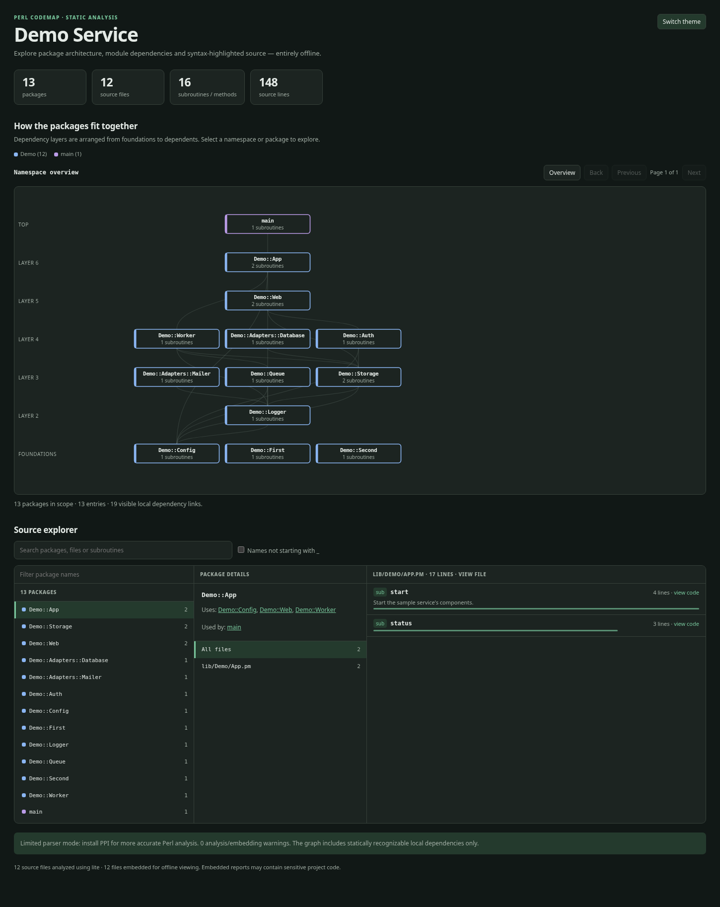
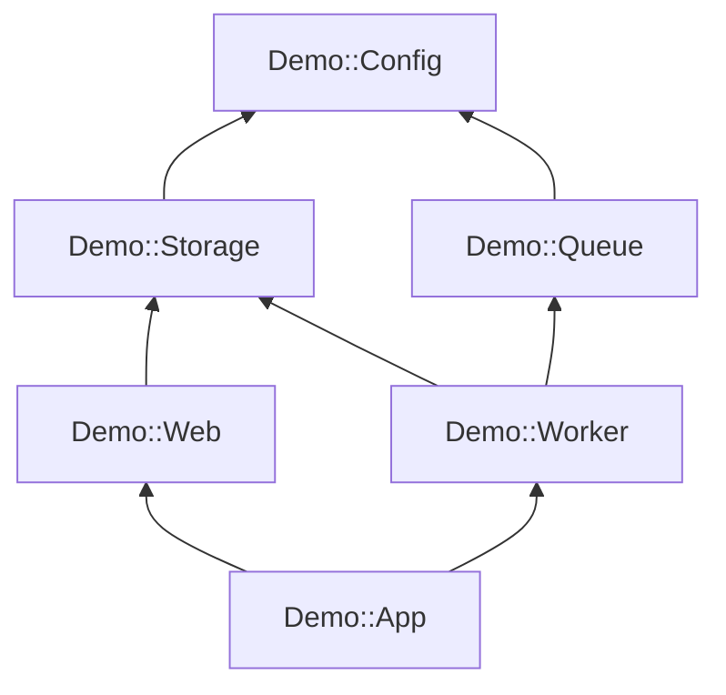

# Perl CodeMap

**A self-contained, interactive architecture map for Perl projects.**

Perl CodeMap scans a source tree without executing it, extracts namespace and
subroutine metadata, resolves statically identifiable local module dependencies,
and generates a standalone HTML report with an interactive dependency graph,
searchable symbol index, and syntax-highlighted source browser.

Inspired by [peterretief/codemap](https://github.com/peterretief/codemap),
reimagined for Perl applications that may have multiple packages per file,
interconnected libraries, and circular dependencies.

[](https://metacpan.org/dist/Perl-CodeMap)
[](https://metacpan.org/pod/Perl::CodeMap)

**Available on CPAN:** [Perl-CodeMap](https://metacpan.org/dist/Perl-CodeMap),
published by [Scott Muller (MULLER)](https://metacpan.org/author/MULLER).
Try the [live interactive sample](https://interrupt21h.github.io/perl-codemap/).



## Features

- **Interactive package map** with dependency-based layers, namespace grouping,
  direct dependency/dependent navigation, highlighted edges, and cycle-aware layout.
- **Perl-aware static analysis** using PPI when installed, with an explicitly
  limited, dependency-free fallback parser.
- **Searchable explorer** for namespaces, files, subroutines and methods, with
  file/line metadata and brief documentation comments.
- **Built-in syntax-highlighted source viewer** with line numbers, file/line
  deep links, and optional repository links. Bundles PrismJS; no CDN required.
- **Single HTML file**, viewable offline without a web server; optional JSON
  export for downstream tooling.
- **Suitable for large source trees** through namespace drill-down, bounded graph
  views, and capped search-result rendering.
- **Safe by design:** source files are parsed, never loaded or executed.

## Requirements

- Perl **5.20 or newer**.
- Perl core modules (including JSON::PP and ExtUtils::MakeMaker).
- [PPI](https://metacpan.org/pod/PPI) **recommended** for accurate static parsing.
- A modern browser for the report. JavaScript is required; network access is not.

## Install from CPAN

Install the published distribution using [cpanm](https://metacpan.org/pod/App::cpanminus):

```sh
cpanm Perl::CodeMap
cpanm PPI  # recommended for accurate structural parsing
perl-codemap --version
perl-codemap --help
```

The published module is [Perl::CodeMap](https://metacpan.org/pod/Perl::CodeMap)
and the installed command is `perl-codemap`. `PPI` is a recommended,
optional dependency; without it, CodeMap can use its limited lite parser.
Use a local Perl environment (for example, `local::lib`) if you do not have
permission to install into the system Perl.

## CLI and module documentation

The installed application includes an extensive Perl POD manual:

```sh
perl-codemap --help           # synopsis and every CLI option
perl-codemap --man            # full manual, examples, return codes, privacy
perldoc perl-codemap          # installed command manual
perldoc Perl::CodeMap         # constructor, public API, output data, errors
man perl-codemap              # Unix manual page (when installed)
```

The documentation shown by `--help`, `--man`, `perldoc`, and the generated
man page comes from the same embedded command POD. The
[Perl::CodeMap API on MetaCPAN](https://metacpan.org/pod/Perl::CodeMap)
documents all public methods, plus complete CLI quick-start instructions.

## Install from the repository

```sh
# In a cloned checkout
cpanm PPI                        # recommended, optional
perl Makefile.PL
make
make test
sudo make install               # optional: installs perl-codemap on PATH
```

For a source-checkout-only run, no installation is necessary:

```sh
perl bin/perl-codemap --root examples/sample --parser lite \
  --output example.html --json example.json
```

Open `example.html` locally. It contains sample application code only.

## Public live demo on GitHub Pages

The GitHub Actions workflow publishes a **regenerated** interactive report
from `examples/sample/` to GitHub Pages on successful pushes to `main`.
The Perl and JavaScript CI test jobs must pass before the deployment starts.
The published root page (`index.html`) **is** the interactive demo; no
web server or build tool is required on the client.

To enable deployment, open **Settings → Pages → Build and deployment →
Source → GitHub Actions** in your GitHub repository, then push to `main`.
The live sample is available at **[https://interrupt21h.github.io/perl-codemap/](https://interrupt21h.github.io/perl-codemap/)**.

The workflow deliberately scans only the synthetic example and uploads
only `_site`, never the repository root, JSON exports, or internal source trees.
See [GitHub Pages deployment](docs/GITHUB_PAGES.md) for setup, troubleshooting
and safety considerations.

## Scan an actual project

```sh
perl-codemap \
  --root /path/to/my-project/lib \
  --parser ppi \
  --name 'My Perl Project' \
  --output code-map.html \
  --json code-map.json
```

To include test files, add `--include-tests`. A report embeds source code by
default so functions can be opened without network access. To avoid embedding:

```sh
perl-codemap --root /path/to/my-project/lib --no-embed-source \
  --output architecture-only.html
```

See [CLI and usage](docs/USER_GUIDE.md) for complete options, GitLab/GitHub
source links, navigation examples, and common troubleshooting steps.

### Re-render an existing JSON export

```sh
perl-codemap --from-json old-map.json --output new-map.html
```

To add highlighted source to an export created without source content, pass
its **original scan directory**:

```sh
perl-codemap --from-json old-map.json \
  --root /path/to/original/scan-directory \
  --output map-with-source.html
```

The exporter only reads paths under the selected source directory, and rejects
absolute or traversal paths when hydrating source from JSON.

## How the graph works

It uses **local package-level dependencies**, not function call inference:



A directed connection means *the source module depends on the target module*.
The layout places foundations below dependents. Strongly connected components
are handled without recursion loops; cycle edges are distinguished visually.
See [architecture](docs/ARCHITECTURE.md) for graph limitations and data flow.

## Quality and tests

```sh
prove -Ilib -v t
node --check lib/Perl/CodeMap/assets/app.js
node t/browser-smoke.js
```

CI runs Perl tests across multiple supported interpreter versions, both lite
and PPI parsing paths, and JavaScript smoke checks. An optional Chromium
end-to-end script is provided for development (see [contributing](CONTRIBUTING.md)).

## Known limitations

Static `use`, named `require`, `use parent`, `use base`, `extends`, and `with`
relations are recognized when resolvable to a package **inside the scanned
root**. Dynamic `require`, `AUTOLOAD`, monkey-patching, runtime method dispatch,
Catalyst action routing, DBIx::Class relationships, and Moose/Moo method
modifiers are not fully modeled. Multiple `package` statements per file are
supported; temporary block-scoped package declarations are best effort.
PPI does not provide full runtime execution semantics.

The lite parser is intentionally heuristic. For projects with complex Perl
syntax, use `--parser ppi`.

## Security and privacy

**HTML and JSON reports can contain complete source files, secrets, or private
paths.** Do not publish generated reports from private repositories. The public
Git repository should contain only this application and synthetic examples.
Read [SECURITY.md](SECURITY.md) before publishing artifacts or enabling CI.

## Project documentation

- [User guide and CLI](docs/USER_GUIDE.md)
- [Installed CLI manual](bin/perl-codemap) (POD; use `perl-codemap --man`)
- [Architecture and limitations](docs/ARCHITECTURE.md)
- [JSON data format](docs/JSON_FORMAT.md)
- [Development and release process](docs/DEVELOPMENT.md)
- [Versioned release procedure](docs/RELEASING.md)
- [Public repository and CPAN publishing guide](docs/PUBLISHING.md)
- [Contributing](CONTRIBUTING.md)
- [Security policy](SECURITY.md)
- [Changelog](CHANGELOG.md)
- [Attribution and notices](NOTICE.md)

## Maintainer

**Scott Muller** — [scott@21h.io](mailto:scott@21h.io).

Issues, fixes, and contributions are welcome; see [CONTRIBUTING.md](CONTRIBUTING.md).

## License

MIT — see [LICENSE](LICENSE). Perl CodeMap is a separate project inspired by
Peter Retief's MIT-licensed Go CodeMap; see [NOTICE.md](NOTICE.md). Vendored
PrismJS components retain their own MIT license.
