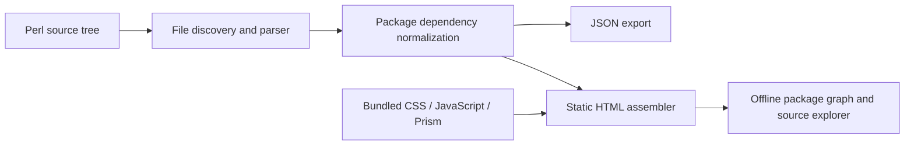

# Architecture

Perl CodeMap has two independent stages: Perl static extraction and an offline
browser visualization. Both stages share a versioned JSON-compatible data
structure. Neither compiles nor executes the analyzed files.

## Analyzer (`lib/Perl/CodeMap.pm`)

The scanner uses `File::Find` with directory pruning and no symlink following,
reads source as bytes, and extracts events describing `package`, `sub` and
recognized `use`/inheritance declarations. The PPI path queries
`PPI::Statement::Package`, `PPI::Statement::Sub`, and
`PPI::Statement::Include` nodes. Calls use documented PPI methods such as
`namespace`, `name`, `block`, `module`, `type`, and `location`. It supplements
PPI with lexical scanning for declarative `method`, `extends`, `with`, and
`parent`/`base` patterns, which PPI alone does not convert into a call graph.

The lite parser masks comments, simple strings, POD and common heredocs, then
uses conservative textual rules. It is a **fallback**, not a general Perl
parser. Complex regex syntax, multiline literals, source filters and dynamic
constructs can still produce false positives or incomplete results. This is
why the PPI mode is recommended.

Package ownership is determined by the current top-level `package` declaration
at each event line. Multiple namespaces per file work; deeply nested and
block-scoped `package Foo {}` declarations have known limitations. Directives
that refer to nonexistent local namespaces are filtered from rendered edges,
though they may be relevant external dependencies.

## Graph (`app.js`)

The viewer computes the package graph once and prepares reverse dependency
indexes in O(V + E) time. A namespace overview groups many packages into
logical subtrees and aggregates edges between groups. Each visible subgraph is
limited to at most 32 nodes. Tarjan's strongly connected components algorithm
collapses cycles into components, then performs longest-path layering on the
acyclic condensation. Drawing is done entirely in inline SVG with browser-side
interaction.

The focus view shows the selected package, up to six direct dependents above
and six direct dependencies below. Counts disclose additional neighbors not
shown. A complete graph of thousands of packages is intentionally not drawn
as one huge SVG.

The source explorer retains all symbol records in memory but caps simultaneous
package rows to 180 and global search-result rows to 300. This keeps browsers
responsive with large datasets; it is not a limit on the analysis export.

## Source viewer and assets

The HTML assembler embeds the JSON data after escaping `<`, `>` and `&` to
prevent source strings from terminating the JSON script element. It bundles
all CSS, JavaScript and Prism's core/Perl grammar into one HTML file.

For source navigation, only a 160-line window is rendered at once. Prism
highlights each window and HTML token markup is split into individually
numbered rows while preserving syntax classes. Browser DOM text inserted from
metadata is escaped; report JavaScript never sends source to a server.

## Security boundaries

`--from-json --root` only reads paths relative to the chosen root. It rejects
absolute paths, `..` traversal, null bytes, and direct symlinks; resolved
source paths must remain below the canonical root. Scan output itself may
contain sensitive code or paths. Separate *source-code safety* (not executing
input) from *artifact confidentiality* (report may disclose source).

## Extensibility

The JSON is documented in [JSON_FORMAT.md](JSON_FORMAT.md). Future development
could add first-class symbols/edges for Catalyst route actions,
`DBIx::Class` relationships, Moose method modifiers, more accurate package
scoping, external dependencies, and incremental scanning. These are **not**
currently claimed as implemented features.
