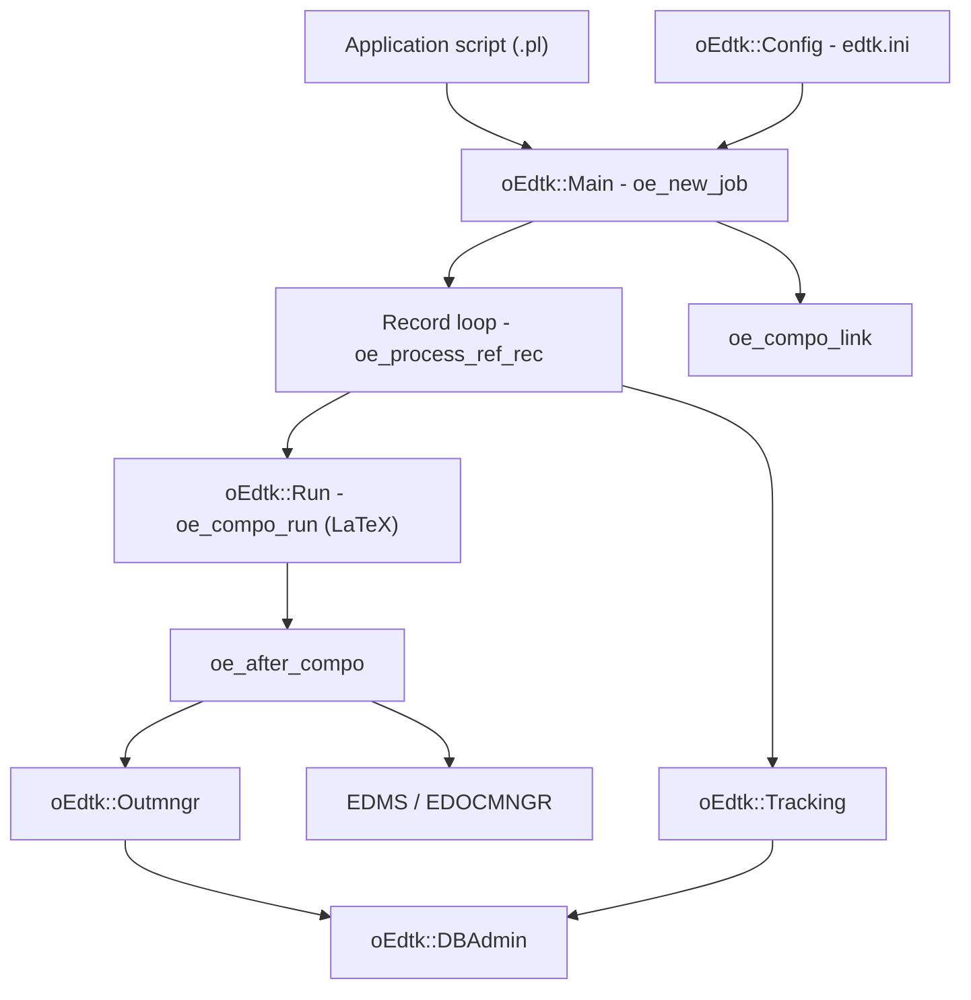

# oEdtk

**oEdtk** is a Perl 5 toolkit for **industrial printing processing**. It provides the
generic building blocks needed to write applications that parse fixed-record data
streams (COBOL copybooks, XML or plain text) and turn them into composed documents
(LaTeX/PDF, CSV, Excel) and database content: letters, mailings, invoices, banking
statements, and similar high-volume productions.

- **Purpose**: parse a data stream, extract records, and drive document composition
  and tracking at production scale.
- **Problem it solves**: it factors out the repetitive plumbing of industrial
  document workflows (record unpacking, template-driven output, LaTeX composition,
  database loading, index/output management, tracking) so that each application only
  implements its own business rules.
- **Intended users**: developers and integrators building editorial-production
  applications, and maintainers operating those applications in production.
- **Main benefits**: one consistent parsing/composition model, a documented
  configuration layer, support for several database engines, and a large
  non-regression suite.
- **Maturity**: a stable, CPAN-style release (`2.1129`). No module carries an
  explicit "experimental" label; the runtime environment defaults to `Dev`
  (`EDTK_TYPE_ENV=Dev` in the shipped template). Some modules are legacy and kept
  only for compatibility - see [Limits and constraints](#limits-and-constraints).

Main features at a glance:

- Fixed-record parsing driven by per-record "motifs" and output templates.
- LaTeX composition (`pdflatex`) with an output manager for lots and batches.
- Database administration: schema create/detect/upgrade/historise, bulk CSV load,
  backup buffering (PostgreSQL, MySQL/MariaDB, SQLite, Oracle).
- Document tracking and statistics.
- XML reading against DTD/XSD, and Cameleon-style readers.
- Optional network services: e-mailing, ECM injection, Keycloak, dissemination plan.
- A plug-in mechanism to attach corporate code without a registry.

## Table of contents

- [Presentation](#presentation)
- [Quick start](#quick-start)
- [Requirements](#requirements)
- [Installation](#installation)
- [Configuration](#configuration)
- [Usage](#usage)
- [Use cases](#use-cases)
- [Features](#features)
- [Tests and validation](#tests-and-validation)
- [Architecture](#architecture)
- [Modules](#modules)
- [Public interfaces](#public-interfaces)
- [Limits and constraints](#limits-and-constraints)
- [Troubleshooting](#troubleshooting)
- [Development and contribution](#development-and-contribution)
- [License, security and support](#license-security-and-support)

## Presentation

oEdtk is not a single program: it is a **library plus a set of shipped helper
scripts**. The core (`lib/oEdtk.pm` and the modules under `lib/oEdtk/`) is generic and
self-contained; an application is a small Perl script you write that combines the
pieces. The main entry point of an application is `oEdtk::Main`, which reads the
configuration, opens the input/output handles and drives the record loop and the
composition back-end.

A companion distribution, **oEUser**, carries the modules that only specific
applications need (user-side address helpers, generated record descriptors,
editor-specific XML readers, and the document-injection client). It is a **separate
distribution** and is **not a prerequisite** of oEdtk: the thin `oEdtk::*` delegates
resolve the corresponding `oEUser::*` modules on demand, and fail with an explicit
message when the companion is absent. See [`oEUser/README`](oEUser/README).

This document covers the repository **and** the shipped Perl package (`README.md` is
included in the distribution tarball).

## Quick start

The shortest path to a first run:

1. **Prerequisites** - a Perl 5 interpreter (see [Requirements](#requirements)) and
   the XML-LibXML module. On Debian/Ubuntu:
   `sudo apt-get install perl libxml-libxml-perl`.
2. **Install** - from CPAN:

   ```sh
   cpan oEdtk
   ```

   or, from a checkout:

   ```sh
   perl Makefile.PL && make && make test && make install
   ```

3. **Verify** the module loads and reports its version:

   ```sh
   perl -MoEdtk -e 'print oEdtk_release()'
   ```

   Expected output: a banner line `(c) 2005-2026 oedtk@free.fr - oEdtk v2.1129`.

4. **Write a minimal application** (`myapp.pl`) using the fixed-record model
   (see [`lib/oEdtk.pm`](lib/oEdtk.pm) SYNOPSIS):

   ```perl
   use strict;
   use oEdtk::Main;

   oe_new_job( $ARGV[0], $ARGV[1] );      # input file, output file
   oe_rec_motif( "016", "A67 A20 A*" );   # declare record keyed '016'
   oe_rec_output( "016", "<SK>%s<#DATE=%s><SK>%s" );

   while ( my $line = <IN> ) {
       chomp $line;
       oe_process_ref_rec( 0, 3, $line );  # offset, key length, line
   }
   oe_compo_link( $ARGV[0], $ARGV[1] );    # close handles, finalise
   ```

5. **Run it**:

   ```sh
   perl myapp.pl input.txt output.tex
   ```

   `myapp.pl` reads `input.txt`, unpacks every `016` record, builds the declared
   output, and writes it to `output.tex`. Producing a **PDF** additionally requires a
   LaTeX toolchain and a populated configuration (see
   [Configuration](#configuration)); without them, the composition back-end cannot
   run.

## Requirements

### Operating systems

oEdtk is pure Perl 5 and runs on Linux, macOS and Windows. The **shipped helper
scripts and the shipped `edtk.ini` template** assume Unix-style paths
(`/usr/bin/perl`, `/usr/bin/gs`, `/usr/bin/pdftk`); on Windows they must be adapted.
There is no stated minimum OS version.

### Runtime

- **Perl >= 5.028** (`Makefile.PL` `MIN_PERL_VERSION`).

### System libraries

- **XML-LibXML** (`>= 1.70`) and its underlying **libxml2**, used for XML input. On
  Windows install it with PPM; on Linux with the distribution's package manager. If
  libxml2 lives in a non-standard location, see [Installation](#installation).

### Perl dependencies

Declared in [`Makefile.PL`](Makefile.PL) (`PREREQ_PM`) and mirrored in the generated
[`cpanfile`](cpanfile). Key ones, with the pinned floors:

| Module | Floor | Used for |
|---|---|---|
| `Config::IniFiles` | 2.30 | reading `edtk.ini` |
| `DBI` | 1.60 | all database access |
| `XML::LibXML` | 1.70 | XML input |
| `XML::XPath` | 1.13 | XPath queries |
| `Text::CSV` | 1.20 | CSV parsing |
| `Spreadsheet::WriteExcel` | 1.00 | Excel output |
| `Math::Round` | 0.06 | numeric formatting |

Plus, among others: `Archive::Zip`, `Date::Calc`, `Email::Sender::Simple` and
`Email::Sender::Transport::SMTP`, `JSON`, `JSON::PP`, `Data::UUID`, `File::Slurp`,
`IPC::Run3`, `LWP::UserAgent` and the `HTTP::*` modules, `IO::Socket::SSL`,
`Log::Log4perl`, `PDF::Create`, `PDF::Tk`, `Readonly`, `Regexp::Common`,
`Term::ReadKey`, `Text::CSV_XS`, `Time::HiRes`, `Try::Tiny`, `YAML::Tiny`, and
`CGI` + `CGI::FormBuilder` (the CGI front-ends load these at the top level, so they
are hard requirements). A full install pulls all of them.

### Database drivers

`DBI` is a hard requirement; the driver depends on the engine:

- **`DBD::SQLite`** - a hard requirement (SQLite is the default file-backed engine).
- **`DBD::Pg`** and **`DBD::mysql`** - *recommended* (declared in `META_MERGE`), needed
  for PostgreSQL and MySQL/MariaDB.
- **`DBD::Oracle`** - optional; not installed by default (it needs the Oracle client
  to build).
- **`DBD::Excel`**, **`DBD::MariaDB`** - optional (MariaDB is reached through
  `DBD::mysql`).

Installing the package never requires a database driver beyond `DBD::SQLite`: the
PostgreSQL and MySQL drivers are recommends, not test requirements, so a plain
`cpan oEdtk` does not try to build them. The corresponding integration facets skip
when the driver is absent.

### Optional modules

- **`Text::QRCode`** - *recommended* (declared in `META_MERGE`), needed only by
  `oEdtk::TexDoc::append_qr_code`. It builds against the native **libqrencode**
  library; the module is loaded lazily on the first QR code and the call fails
  with an explicit message when it is absent.

### External programs (per feature)

- A **LaTeX distribution** providing `pdflatex` / `latex` for PDF/DVI composition
  (paths configured under `[COMPO]`).
- **Ghostscript** (`gs`) and **pdftk** for the EDMS document path (`[EDOCMNGR]`).
- An **SMTP** relay / send-mail facility for the mailing features.
- **Docker** and `docker compose` - only for the test databases (see
  [Tests and validation](#tests-and-validation)).

### Development and test extras

`Perl::Tidy`, `Perl::Critic`, `Test::Fatal`, `Test::MockModule`, `Test::Fake::HTTPD`,
`Test::More >= 1.302`, `IPC::Run3` (declared in `TEST_REQUIRES`). The PostgreSQL and
MySQL integration facets additionally need `DBD::Pg` / `DBD::mysql`; they are
optional and the facets skip when the driver is absent.

## Installation

Methods are listed from the simplest to the most advanced.

### From CPAN (recommended)

```sh
cpan oEdtk        # or: cpanm oEdtk
```

Pulls the dependencies and installs the modules. **Verify**:
`perl -MoEdtk -e 'print oEdtk_release()'`.

### From source (a checkout of this repository)

```sh
perl Makefile.PL
make                # use 'dmake' on Win32
make test
make install
make clean
```

If libxml2 is in a non-standard location, pass include/library paths:

```sh
perl Makefile.PL LIBS='-L/usr/lib' INC='-I/usr/include/libxml2'
```

**Verify**: `make test` reports the test count, and `perl -MoEdtk -e1` loads cleanly.

### Windows (ActivePerl / PPM)

Install XML-LibXML (and `dmake`) with PPM, then run the same source steps with `dmake`
instead of `make`.

### Optional companion distribution

`oEUser` is a **separate** distribution (see [`oEUser/README`](oEUser/README)); it
requires oEdtk **2.1120** or later. Install it with the same
`perl Makefile.PL && make && make install` sequence from the `oEUser/` directory.

## Configuration

### Where the configuration comes from

The configuration is an INI file (`edtk.ini`) read by `oEdtk::Config::config_read`
([`lib/oEdtk/Config.pm`](lib/oEdtk/Config.pm)). Resolution order:

1. `edtk.ini` next to the running script (`$Bin/edtk.ini`);
2. otherwise `<libdir>/iniEdtk/edtk.ini`;
3. otherwise the shipped template `<libdir>/iniEdtk/tplate.edtk.ini`.

The `iniEdtk` key of the host-name section (`[<UPPERCASE-HOSTNAME>]`) can redirect the
read to another file; the literal value `local` disables the redirection. Merging is
`[DEFAULT]` -> `[ENVDESC]` -> the sections the caller requests -> the host-name section
(last wins). `config_read` injects `EDTK_HOST`, `USERNAME`, `EDTK_PRGNAME` (from `$0`)
and `EDTK_PRGPATH` (the script directory, i.e. `$Bin`), and expands `$name` references.

### The template

Start from the shipped template
[`lib/oEdtk/iniEdtk/tplate.edtk.ini`](lib/oEdtk/iniEdtk/tplate.edtk.ini) and adapt it.
Its sections:

| Section | Role |
|---|---|
| `[DEFAULT]` | Global starting values (corporation, dictionaries, language, log level). |
| `[ENVDESC]` | The runtime directory model (`EDTK_DIR_*`, file stems, extensions, timeouts). |
| `[EDTK_DB]` | Database DSNs, users, retention, primary-key mode, bulk-load tuning. |
| `[EDTK_STATS]` | Statistics DSNs and canned SQL queries. |
| `[MAIL]` | Mail recipients, sender, subject, SMTP host. |
| `[COMPO]` | LaTeX back-end, commands, line cutoff, batch-id format. |
| `[EDOCMNGR]` | EDMS/GED index columns, formats, FTP host, lookup URL. |
| `[SERVICES]` | Optional network services - inactive by default. |
| `[MYHOSTNAME]` | Example host-name override section (always uppercase). |

### Key lexicon

Every key the shipped template sets, by section, with what it drives and the values that
change behaviour. A `$name` value (for example `$EDTK_DIR_BASE`) is expanded by
`config_read`; an empty *Special values* cell means the value is free-form or has no
special literal.

**[DEFAULT]**

| Key | Usage | Special values |
|---|---|---|
| `iniEdtk` | Redirects the read to another ini file; also read from the host-name section. | `local` disables the redirect. |
| `EDTK_CORP` | Corporation name printed in the generated documents. | |
| `EDTK_DICO` | Main dictionary (accents, entities) loaded by the text layer. | |
| `EDTK_DICO_POST` | Postal-code dictionary. | |
| `EDTK_SNIP_ADDR` | Address-snipping dictionary. | |
| `EDTK_SNIP_RATE` | Address-snipping rate. | `0` disables snipping. |
| `EDTK_LANG` | Language, i.e. the dictionary section to read. | e.g. `EN`, `FR`. |
| `EDTK_LOG_LVL` | Log sensitivity read by `oEdtk::logger` (its `$LOGGERLEVEL`). | `4` is the mainline default. |

**[ENVDESC]** - directories, file stems, extensions and timeouts. Every path is written
relative to `EDTK_DIR_BASE` (default `$EDTK_PRGPATH`, the running script's directory) and to
`EDTK_PRGNAME` (injected at runtime).

| Key | Usage | Special values |
|---|---|---|
| `EDTK_DIR_BASE` | Root of the whole path tree. | default `$EDTK_PRGPATH`. |
| `EDTK_DIR_APP`, `EDTK_DIR_SCRIPT` | Application root / per-application script directory. | |
| `EDTK_DIR_CONFIG` | Configuration files and dictionaries. | |
| `EDTK_DIR_APPTMP`, `EDTK_DIR_DB` | Temporary work area / database files. | |
| `EDTK_DIR_DATA_IN` | Input flux directory. | |
| `EDTK_DIR_LIB`, `EDTK_DIR_TMPLATE` | Shared libraries / document templates. | |
| `EDTK_DIR_OUTMNGR`, `EDTK_DIR_EDOCMNGR`, `EDTK_DIR_DOCLIB` | Output, EDMS transit and document library. | |
| `EDTK_DIR_LOG`, `EDTK_DIR_DOCSCRIPT` | Logs / per-application document area. | |
| `EDTK_DOCLIB_LOCK` | Document-library lock file. | |
| `EDTK_FDATAIN`, `EDTK_FDATAOUT`, `EDTK_FDATWORK` | Input / output / work file stems. | |
| `EDTK_TYPE_ENV` | Environment label, prefixed to mail subjects by the messenger. | `Dev` (default), `Test`, `Production`. |
| `EDTK_OUTMNGR_MERGE` | Whether the outgoing-routeur output is merged. | `no` (default) / `yes`. |
| `EDTK_PRGNAME` | Running program name (injected). | |
| `EDTK_VCS_LOCATION` | Version-control location recorded in outputs. | |
| `EDTK_WATERMARKTEXT` | Watermark stamped on generated documents. | |
| `EDTK_BIN_PERL` | Path to the Perl interpreter used when bundling. | |
| `EDTK_EXT_COMP_OMGR` | Extension of the routeur-composed files. | `omgr`. |
| `EDTK_EXT_COMPO` | Extension of a composed file. | defaults to `$EDTK_EXT_LATEX`. |
| `EDTK_EXT_DATA`, `EDTK_EXT_DEFAULT` | Data-file extension / default extension. | `DAT` / `$EDTK_EXT_PDF`. |
| `EDTK_EXT_EXCEL`, `_LATEX`, `_PCL`, `_PDF`, `_PERL`, `_WORK` | Extensions per artefact type. | `xls`, `tex`, `pcl`, `pdf`, `pl`, `txt`. |
| `EDTK_WAITRUN` | Seconds to wait for a child process. | default `8`. |
| `EDTK_XLS_MAX_ROW` | Maximum rows read from an XLS sheet. | default `30000`. |

**[EDTK_DB]** - database DSNs, credentials, retention, primary-key mode and bulk-load tuning.

| Key | Usage | Special values |
|---|---|---|
| `EDTK_DBI_DSN` (+ `_USER`, `_PASS`) | Active DSN and credentials of the main database. | |
| `EDTK_DBI_DSN_BAK` (+ `_USER`, `_PASS`) | DSN and credentials of the backup database. | |
| `EDTK_DBI_PARAM` | DSN of the parameter database. | |
| `EDTK_DBI_ACQUIT`, `_DISTRIB`, `_DISTRIB_STATS`, `_OUTMNGR`, `_OUTMNGR_STATS`, `_TRACKING` | Logical table names of the acquittal, distribution, distribution-stats, outgoing, outgoing-stats and tracking tables. | |
| `EDTK_MAX_USER_KEY` | Number of user tracking keys accepted. | `10` (mainline) / `5` (fork). |
| `EDTK_TRACKING_KEYS` | Comma-separated extra tracking columns. | |
| `EDTK_TRACK_MODE` | Tracking back-end. | `SQLite` (default) / `none` (tracking off). |
| `EDTK_TRACK_SIG` | Which signals the tracker catches. | `warn` (all) / `halt` (die only); `no` disables. |
| `EDTK_DB_MAX_DAYS_KEPT`, `_KEPT_STATS`, `_TRACKED`, `_AGREGED` | Retention in days of the main, stats, tracking and aggregated tables. | `2`, `100`, `400`, `600`. |
| `EDTK_DB_CHECK_AUTO` | Enables the automatic consistency check. | `NO` (default) / `YES`. |
| `EDTK_DB_CHECK_MONTH_DAY` | Day of month for the automatic check. | default `15`. |
| `EDTK_DB_PK_IDJOB` | Keeps `ed_idjob` in the INDEX primary key. | `yes` (mainline) / any other value (fork schema). |
| `EDTK_DB_IDJOB_DEFAULT` | Value written to `ed_idjob` when the key is kept. | empty until the S51 gate. |
| `EDTK_DB_FetchHashKeyName` | Case-folding of fetched column names (`FetchHashKeyName`). | `NAME_uc` (default). |
| `EDTK_DB_COPY_ENCODING` | Source encoding of the CSV bulk-load path. | `UTF8` = file already UTF-8; empty = legacy (Latin-1). |
| `EDTK_DB_DEFER_INDEX_RATIO`, `_MIN_ROWS` | Index-deferral policy of the PostgreSQL bulk load (opt-in). | empty = off; when set, defaults `0.1` / `10000`. |
| `EDTK_DB_BURST_MO` | ELT staging threshold, in MiB, on PostgreSQL. | `50` (default); `0` disables; empty/invalid falls back to 50. |

**[EDTK_STATS]**

| Key | Usage | Special values |
|---|---|---|
| `EDTK_DBI_STATS`, `EDTK_DSN_STATS` (+ `_USER`, `_PASS`) | DSN and credentials of the statistics database. | default to the main DSN. |
| `EDTK_STATS_TRACKING`, `_OUTMNGR`, `_DISTRIB`, `_ACQUIT` | Statistics table names. | |
| `EDTK_STATS_MANUFACT` | Manufacturer filter of the outgoing statistics. | comma- or space-separated `ED_IDMANUFACT` codes; empty = all. |
| `EDTK_CSV_HEADER_METADATA`, `EDTK_CSV_HEADER_DISTRIB` | Column order of the CSV exports. | |
| `EDTK_STATS_SQL00`..`SQL12`, `SQL90` | Named canned SQL queries of the statistics panel. | `SQL90` may name a `.sql` file (`$EDTK_PRGPATH/sql/...`). |

**[MAIL]**

| Key | Usage | Special values |
|---|---|---|
| `EDTK_MAIL_TO`, `EDTK_MAIL_TST` | Production / test recipient. | |
| `EDTK_MAIL_SENDER` | Envelope sender. | |
| `EDTK_MAIL_SUBJ` | Subject template. | `%date` and `%time` are substituted. |
| `EDTK_MAIL_SMTP` | SMTP relay host. | |
| `EDTK_MAIL_REFER`, `EDTK_MAIL_OMGR` | Body templates of the recap / outgoing mail. | |
| `EDTK_MAIL_LIST_1`..`_5` | Named distribution lists. | |

**[COMPO]** - the LaTeX back-end.

| Key | Usage | Special values |
|---|---|---|
| `EDTK_BIN_COMPO` | Directory holding the TeX binaries. | |
| `EDTK_COMPO` | The composition command. | e.g. `pdflatex -halt-on-error`. |
| `EDTK_COMPO_CMD_PDF`, `_DVI`, `_DVIPDF` | Per-format composition commands. | |
| `EDTK_COMPO_LIB` | Path to the `edtkdoc.cls` class file. | |
| `EDTK_FILIERES_RECTO_VERSO` | Channels whose index is padded to an even page count. | empty = none. |
| `EDTK_CMD_RUN_BG_NOWAIT` | Non-blocking background composition. | empty = blocking; set = non-blocking. |
| `EDTK_LINE_CUTOFF` | Maximum characters before a newline in generated documents. | empty falls back to `120`. |
| `EDTK_RP_KILL_NON_LATIN` | Strips non-Latin-1 (DEL and C1) characters from input records. | off by default. |
| `EDTK_IDLDOC_FORMAT` | Document batch-id format. | `UUID` (default) / `LEGACY` or `old` (16-digit id, case-insensitive). |
| `EDTK_COMPO_ASYNC` | Asynchronous composition (commented out in the template). | `yes` / `no`. |

**[EDOCMNGR]** - EDMS/GED indexing and transfer.

| Key | Usage | Special values |
|---|---|---|
| `EDMS_INDEX_COLS` | Columns of the EDMS index. | |
| `EDMS_DATE_FORMAT` | Date format used in the index. | `%Y/%m/%d`. |
| `EDMS_IDX_FORMAT` | Index format. | `DOCUBASE` (default) / `SCOPMASTER`. |
| `EDMS_IDX_HEADER` | Index header line (`;`-separated). | |
| `EDMS_ACTIVATE_HEADER_ALFRESCO` | Emits the Alfresco header line. | `YES` / `NO`. |
| `EDMS_FTP_HOST`, `_PORT`, `_USER`, `_PASS` | FTP(S) transfer target. | |
| `EDMS_FTP_DIR_IDX`, `_DIR_DOCS` | Remote index / document directories. | |
| `EDTK_EDOCS_LINK` | Base URL of the document link. | |
| `EDMS_HTML_HOST` | HTML host used to build the lookup URL. | |
| `EDMS_URL_LOOKUP` | Lookup URL template. | `%s` and `%d` placeholders. |
| `EDMS_BIN_GS`, `EDMS_BIN_PDFTK` | Ghostscript / pdftk binaries. | |

**[SERVICES]** - optional network services. All are inactive by default: an empty value keeps
the mainline behaviour.

| Key | Usage | Special values |
|---|---|---|
| `NWS_EMAILING_URI` | E-mailing service base URL. | empty = unused (`/emails` is appended). |
| `EMAILING_TEMPLATE`, `EMAILING_USER_AGENT` | E-mailing template name / User-Agent string. | empty = each client's shipped default. |
| `KEYCLOAK_URL`, `_CLIENT_ID`, `_SECRET_ID` | Keycloak token endpoint and client credentials. | all three required together. |
| `KEYCLOAK_REALM` | Keycloak realm path element. | empty = the client's shipped default. |
| `DISSEMINATION_PLAN_URL` | Dissemination-plan service URL. | empty = the step is skipped. |
| `EDTK_SSL_VERIFY` | TLS peer and host-name verification. | `1` (default, safe) / `0` (private CA only). |
| `EDTK_SSL_CA_PATH` | CA bundle, a file or a directory. | empty = system trust store. |
| `EDTK_ACQUIT_API` | Named acquittal callable, `Module::function`. | empty = no API acquittal. |
| `EDTK_MAIL_ACQ` | Recipients of the acquittal recap report. | empty = no report. |
| `APIECM_URL`, `APIECM_APIKEY_EDITIQUE` | ECM API base URL and the static editique API key. | empty = the ECM injector is unusable. |

**[MYHOSTNAME]** - a worked example of a host-name override section. Section names are always
uppercase; a section matching `uc(hostname())` is merged last, so it wins, and its `iniEdtk`
key can redirect the whole read.

A few keys the code reads are not shipped in the template and stay optional: `EDTK_DICO_COUNTRY`
(country dictionary), `EDTK_DICO_XLAT` (LaTeX character translation), `EDTK_XML_CATALOG_FILES`
(XML catalogs, read from `[MAIL]`), `EDTK_DB_STORAGE_ENGINE` (MySQL storage engine, default
`MyISAM`), `EDTK_ENTIRE_YEARS_KEPT` and `EDTK_STATS_DAYS_FROM` (retention / history windows).

### The runtime directory model

`[ENVDESC]` defines every path relative to `EDTK_DIR_BASE` (which is set to the script
directory at runtime) and to `EDTK_PRGNAME` (the running program name). The main ones:

- `EDTK_DIR_APP` / `EDTK_DIR_SCRIPT` - application root and the per-application script
  directory;
- `EDTK_DIR_CONFIG` - configuration and dictionaries;
- `EDTK_DIR_DATA_IN` (`EDTK_FDATAIN`, `EDTK_FDATWORK`) - input/work files;
- `EDTK_DIR_APPTMP` - temporary work area;
- `EDTK_DIR_OUTMNGR` / `EDTK_DIR_EDOCMNGR` / `EDTK_DIR_DOCLIB` - output, EDMS transit
  and document library;
- `EDTK_DIR_LOG` - logs.

### Environment variables read by the code

Besides the keys above (which are exported into the process environment at runtime),
the code reads a set of `$ENV{...}` variables, including:

- directory/identity: `EDTK_DIR_BASE`, `EDTK_DIR_APP`, `EDTK_DIR_SCRIPT`,
  `EDTK_DIR_APPTMP`, `EDTK_FDATAIN`, `EDTK_FDATAOUT`, `EDTK_PRGNAME`,
  `EDTK_VCS_LOCATION`, `EDTK_INIEDTK`;
- database: `EDTK_DBI_DSN` (+ `_USER` / `_PASS`), `EDTK_DBI_TABLENAME`,
  `EDTK_DBI_TRACKING`, `EDTK_TRACK_MODE`, `EDTK_DBI_AutoCommit`,
  `EDTK_DBI_RaiseError`, `EDTK_DBI_PrintError`, `EDTK_MAX_USER_KEY`;
- behaviour: `EDTK_EXT_DATA`, `EDTK_EXT_DEFAULT`, `EDTK_EXT_LATEX`, `EDTK_EXT_PERL`,
  `EDTK_EXT_WORK`, `EDTK_WAITRUN`, `EDTK_FTYP_DFLT`, `EDTK_FTYP_HOMOL`,
  `EDTK_OPTIONS`.

### Minimal example (no real secret)

```ini
[DEFAULT]
EDTK_CORP      = My Corp
EDTK_LANG      = EN
EDTK_LOG_LVL   = 4

[ENVDESC]
EDTK_DIR_BASE  = $EDTK_PRGPATH
EDTK_DIR_SCRIPT= $EDTK_DIR_BASE/app/$EDTK_PRGNAME

[EDTK_DB]
EDTK_DBI_DSN      = DBI:SQLite:dbname=$EDTK_DIR_SCRIPT/oEdtk_db.tmp
EDTK_DBI_DSN_USER = oedtk
EDTK_DBI_DSN_PASS = change-me
```

### Security

`edtk.ini` can carry database and service passwords. Keep it out of version control,
restrict its permissions, and never commit real credentials. The shipped template uses
placeholder values only.

## Usage

### The application model

An oEdtk application is a small script with a fixed shape (see the
[Quick start](#quick-start) and [`lib/oEdtk.pm`](lib/oEdtk.pm) SYNOPSIS):

1. `oe_new_job($infile, $outfile)` - read the configuration, open the `IN`/`OUT`
   handles, start the composition back-end.
2. Declare each record once: `oe_rec_motif($key, $template)` (mandatory),
   `oe_rec_output($key, $sprintf_template)` and, optionally,
   `oe_rec_pre_process` / `oe_rec_process` / `recEdtk_post_process` to hook user subs.
3. Read the stream line by line and call `oe_process_ref_rec($offset, $keylen, $line)`
   for each - it recognises the record by key, unpacks it into the global `@DATATAB`,
   runs the hooks and builds the output.
4. `oe_compo_link($infile, $outfile)` - close the handles and finalise (emit the LaTeX
   trailer, wait for the composer, optionally import the result).

`oe_new_job` also parses run-time options, among them `--index`, `--massmail`,
`--edms`, `--cgi`, `--noinputfiles` and `--input_code=<code>`.

### The migration CLI

`lib/db_migrate.pl` is a standalone command line over `oEdtk::DBAdmin` that updates a
database schema. Exactly one mode is required:

```sh
perl lib/db_migrate.pl --check-only --dsn <dsn> [--user U] [--pass P]
perl lib/db_migrate.pl --dry-run    --dsn <dsn>
perl lib/db_migrate.pl --historize  --dsn <dsn> [--stamp YYYYMMDD_HHMMSS]
perl lib/db_migrate.pl --revert     --dsn <dsn> --stamp YYYYMMDD_HHMMSS
perl lib/db_migrate.pl --additive   --dsn <dsn> [--with-constraints]
```

| Mode | Effect |
|---|---|
| `--check-only` | Detect the schema level and print the plan. **Nothing is written.** |
| `--dry-run` | Like `--check-only`, plus the copy SQL and a DDL preview. |
| `--historize` | Build a `T` target, copy by named columns, validate, switch over and keep the old schema as history (recommended). A base already at `T` is a no-op unless `--force`. |
| `--revert` | Undo a `--historize` run (`--stamp` required). |
| `--additive` | In-place additive update (add column, widening, `CREATE ... IF NOT EXISTS`) - never a drop, a narrowing or a rename; `--with-constraints` also changes the key after a duplicate pre-check. |

Options: `--dsn`, `--user`, `--pass`, `--stamp`, `--force`, `--with-constraints`. Exit
code `0` on success, `1` on a controlled abort (reason on stderr); `--check-only` and
`--dry-run` are strictly read-only. The password is never printed.

### CGI front-ends

The shipped scripts under `lib/oEdtk/lib/cgi-bin/` provide web front-ends:
`edtk.cgi` (inline composition of an uploaded XML), `edtk_inged.cgi` (push a document
into EDMS), `edtk_ged.cgi` (redirect to the document lookup) and `edtk_para.cgi`
(end-user editor of inline parts). Each is gated by a configuration key named after the
script basename, in the `[EDOCMNGR]` section.

### Helper scripts

`lib/oEdtk/lib/` ships operational scripts, all run as `perl <script> [args]` with
arguments read positionally or from the configuration: database maintenance
(`db_*.pl`), index/output management (`index_*.pl`), tracking statistics
(`tracking_Statistics.pl`), acquittal (`acq_*.pl`), parameters import/export
(`params_*.pl`), and configuration/dev helpers (`check_oEdtk_ini.pl`, `cob2pm.pl`,
`edms_*.pl`, `ged_process.pl`). Shell helpers (`*.sh`) cover backup and go-live steps.

### Inputs and outputs

- **Input**: a fixed-record data stream (or XML for the XML readers). Records are
  identified by a key at a fixed offset/length.
- **Output**: a composed document (LaTeX source -> PDF/DVI), CSV, Excel, and/or rows
  written to a database. Diagnostics go to **stderr**; data and reports go to
  **stdout** (see [`docs/integration/LOGGER.md`](docs/integration/LOGGER.md)).

## Use cases

### 1. Discovery - turn a fixed-record file into a document

*Need*: convert a small file into a readable document.
*Steps*: install oEdtk, copy a minimal `edtk.ini`, write a script that declares the
record motifs and outputs (see [Quick start](#quick-start)), run
`perl myapp.pl input.txt output.tex`.
*Result*: `output.tex` holding one composed block per recognised record.
*Limits*: PDF output needs a LaTeX toolchain and a populated `[COMPO]` section.

### 2. Common - composition with output management

*Need*: produce a batch of documents and register them.
*Steps*: enable `--index` in `oe_new_job`, configure `[EDTK_DB]` / `[COMPO]`, then run
the application; `oe_compo_link` calls `oe_after_compo`, which can import the result
through `oEdtk::Outmngr` and, when configured, EDMS.
*Result*: composed documents plus index rows in the output-manager database.

### 3. Advanced - bulk database load

*Need*: load a large CSV into a table efficiently.
*Steps*: use `oEdtk::DBAdmin::csv_import` with a PostgreSQL DSN to go through the
`COPY FROM STDIN` path; large files may be routed through the staging "ELT" path
(threshold `EDTK_DB_BURST_MO`, default 50 MiB). Pass `force_copy => 1`
(`--forceCopy` in the packaged tracker) to bypass the staging path and force the
parsed COPY path regardless of volume. See
[`docs/dbadmin/D80-report.md`](docs/dbadmin/D80-report.md).
*Result*: the table is loaded; reported row counts match the source.

### 4. Automation - scripted database maintenance and statistics

*Need*: version a schema change or report statistics.
*Steps*: run `lib/db_migrate.pl --dry-run --dsn <dsn>` to preview, then
`--historize` to apply; use `index_Statistics.pl` / `tracking_Statistics.pl` for
reports.
*Result*: a schema update with a reversible history, or a statistics report on stdout.

## Features

### Record parsing and output building

Declare a record with `oe_rec_motif($key, $template)` (an `unpack`-style template; end
it with `A*` to drop trailing data) and an output with
`oe_rec_output($key, $sprintf_template)`. Optional hooks (`oe_rec_pre_process`,
`oe_rec_process`, `recEdtk_post_process`) run user subs around unpacking and output;
`recEdtk_erase` / `recEdtk_redefine` let you ignore or redefine a record mid-stream.
Unpacked values live in the global `@DATATAB`.

### LaTeX composition

`oEdtk::Run` builds and executes the configured LaTeX command (synchronously or through
an asynchronous FIFO), and `oEdtk::Doc` / `oEdtk::TexDoc` build the LaTeX body (tags,
tables, includes, QR codes, escaping).

### Output management

`oEdtk::Outmngr` inserts index lines, assigns lots and filieres, and handles depot,
purge and statistics of document batches.

### Tracking and statistics

`oEdtk::Tracking` records document-level events into the tracking database;
`stats_week`, `stats_iddest` and `stats_month` produce reports.

### Database administration

`oEdtk::DBAdmin` connects (with a retry loop and a store-and-forward backup buffer),
creates and detects schemas, historises/reverts/additively upgrades them, and loads CSV
in bulk. PostgreSQL, MySQL/MariaDB, SQLite and Oracle are supported, with per-engine
SQL differences (e.g. `LOAD DATA INFILE` on MySQL, `COPY` on PostgreSQL).

### XML

`oEdtk::XML::DTD` (parse/validate against a DTD), `oEdtk::XML::XSD` (against an XSD),
`oEdtk::XML::Default` (Cameleon reader) and `oEdtk::XML::Generic` (generic reader plus
schema verification).

### Network services (optional)

`oEdtk::Emailing` (mailing service), `oEdtk::ECM` (ECM document injection),
`oEdtk::Keycloak` (token endpoint), `oEdtk::DisseminationPlan`, and the shared TLS
transport `oEdtk::Net`. All are inactive until configured under `[SERVICES]`.

### Extensions

`oEdtk::Ext` plugs corporate code in without a registry: `require_optional` loads a
companion module by its fixed name (absence is a documented no-op), and
`load_named_callable` / `call_named_callable` resolve a `Module::function` named in the
configuration after validating its name.

## Tests and validation

### Layout

- `t/*.t` - the top-level unit/functional tests (18 files).
- `t/int/*.t` - the integration suite (75 files): numbered ratchet tests guarding
  project invariants, plus database and end-to-end tests.
- `t/lib/oEdtkTest.pm` and `t/lib/TestOEdtk.pm` - test helpers.
- `t/data/*.txt`, `t/golden/`, `t/fixidx-samples/` - fixtures and ratchet baselines.

### Running the suite

```sh
tools/run-tnr.sh                       # SQLite/file tests only
tools/run-tnr.sh --db pg               # also against PostgreSQL
tools/run-tnr.sh --db all              # every database engine
tools/run-tnr.sh --no-start --db pg    # assume the database is already up
tools/run-tnr.sh --no-prereqs -- -j4   # skip the pre-flight, pass prove options
```

`tools/run-tnr.sh` runs the pre-flight dependency check, optionally starts the Docker
test databases, then runs the suites. Under the hood it is:

```sh
prove -Ilib -It/lib -r t
prove -Ilib -IoEUser/lib -r oEUser/t      # when oEUser/ is present
```

**Caveat**: `prove t` without `-r` does **not** descend into `t/int/`; always use `-r`
(or the runner). To run one test or category, pass a path, e.g.
`prove -Ilib -It/lib t/int/15_config.t`.

### Test databases

Docker-based, one-shot test databases live under [`tools/db/`](tools/db/); they mirror
the `tracker/dev/build/docker-compose-*.yml` set (same container names and ports, so
the two never drift):

| Engine | Compose file | Container | Host port | Driver |
|---|---|---|---|---|
| PostgreSQL | `docker-compose-pg.yml` | `postgres_ephemere` | 5432 | `DBD::Pg` |
| MariaDB | `docker-compose-mariadb.yml` | `mariadb_ephemere` | 3307 | `DBD::mysql` |
| MySQL | `docker-compose-mysql.yml` | `mysql_ephemere` | 3308 | `DBD::mysql` |
| Oracle | `docker-compose-oracle.yml` | `oracle_ephemere` | 1521 | `DBD::Oracle` (optional) |

```sh
tools/db/start-db.sh pg        # start (or reuse) the PostgreSQL instance
tools/db/start-db.sh oracle    # first Oracle start creates the PDB (1-3 min)
tools/db/stop-db.sh pg         # stop and remove the volume
```

`start-db.sh` is idempotent (an already-running container is reused). Only loopback
(`127.0.0.1`) is exposed. All engines read the **same** three keys from the git-ignored
`.env` at the repository root (`POSTGRES_DB`, `POSTGRES_USER`, `POSTGRES_PASSWORD`),
copied from `.env.example`; the password is never committed or printed. Prerequisites:
Docker (daemon reachable by the working user) and `docker compose`; images are pulled
on first use.

### Optional and gated tests

Some tests only run when the matching environment is provided:

- PostgreSQL integration: `OEDTK_TEST_PG_ON` (+ `OEDTK_TEST_PG_DSN`, `_USER`, `_PASS`).
- MySQL integration: `OEDTK_TEST_MYSQL_ON` (+ `_DSN`).
- Performance: `OEDTK_TEST_PERF_ON` (optionally `OEDTK_TEST_PERF_SIZES`).
- All engines at once: `OEDTK_TEST_ALL_ON=1` (set by `tools/run-tnr.sh --db all`).

### Code-quality gates

```sh
tools/tidy_all.sh [--dry-run] <path>...   # mechanical perltidy (profile .perltidyrc)
prove -Ilib -It/lib t/int/09_style.t      # perltidy + Perl::Critic (severity 5)
prove -Ilib -It/lib t/int/05_encoding.t   # UTF-8/ASCII + LF everywhere
```

### Interpreting results

A green run reports `Files=..., Tests=..., PASS`. Ratchet tests fail in **both**
directions - when a guarded item appears, and when a recorded item is already fixed -
so a failure means the frozen list and the tree disagree; fix one or the other.

## Architecture

### Components

- **Application script** - yours; declares records and drives the loop.
- **`oEdtk::Main`** - job setup, option parsing, the record loop, output-tag building,
  and the final link.
- **`oEdtk::Record` / `oEdtk::RecordParser`** - the in-memory record and the streaming
  parser.
- **`oEdtk::Run`** - the composition runner (LaTeX command, `oe_after_compo`).
- **`oEdtk::Doc` / `oEdtk::TexDoc` / `oEdtk::LaTeX`** - LaTeX body building.
- **`oEdtk::Config`** - configuration loading.
- **`oEdtk::DBAdmin`** - database access, schema management, bulk load.
- **`oEdtk::Outmngr`** - output-manager index and batches.
- **`oEdtk::Tracking`** - document tracking and statistics.
- **`oEdtk::XML::*`** - XML readers.
- **`oEdtk::Ext`** - extension hook.
- **Thin delegates** (`oEdtk::Emailing`, `oEdtk::Keycloak`,
  `oEdtk::DisseminationPlan`, `oEdtk::Constants`, `oEdtk::Utils`,
  `oEdtk::XML::DTD::Utils`, `oEdtk::Infinite`) - forward to `oEUser::*`.

### Execution flow



### Entry points and extension

The per-application entry point is the application `.pl` (a template ships as
[`lib/oEdtk/lib/template/runEdtk.pl`](lib/oEdtk/lib/template/runEdtk.pl)). The library
entry point is `oEdtk::Main`. The standalone CLI entry point is
[`lib/db_migrate.pl`](lib/db_migrate.pl). Corporate extensions attach through
`oEdtk::Ext` and the configuration, not through a compile-time registry.

### Repository layout

```
Makefile.PL  MANIFEST  MANIFEST.SKIP  README.md  Changes   # packaging
lib/oEdtk.pm                                               # main module
lib/oEdtk/                                                 # core modules
lib/oEdtk/iniEdtk/                                         # config templates, dictionaries
lib/oEdtk/lang/                                            # message catalogues (en, es, fr)
lib/oEdtk/lib/                                             # shipped helper scripts + CGIs + templates
lib/db_migrate.pl                                          # schema-migration CLI
t/                                                         # test suite
oEUser/                                                    # optional companion distribution
docs/                                                      # working documentation (not shipped)
tools/                                                     # maintainer tooling (not shipped)
```

## Modules

Grouped by role (path, responsibility, and the main internal dependencies). This is a
curated map, not an exhaustive listing.

### Core

| Module | Responsibility | Uses |
|---|---|---|
| `lib/oEdtk.pm` | Documentation-only top module; `oEdtk_release`. | - |
| `lib/oEdtk/Main.pm` | Job setup, record loop, output tags, corporation/ID, date helpers. | `Config`, `Run`, `DisseminationPlan` |
| `lib/oEdtk/Config.pm` | Reads `edtk.ini` (`config_read`, `get_ini_path`). | `Config::IniFiles`, `Sys::Hostname` |
| `lib/oEdtk/DBAdmin.pm` | DB connect, schema create/detect/upgrade/historise, bulk CSV load, backup buffer. | `DBI`, `Config` |
| `lib/oEdtk/Outmngr.pm` | Output-manager index, lots, filieres, depot/purge/stats. | `DBAdmin` |
| `lib/oEdtk/Tracking.pm` | Document-level tracking and statistics. | `Main`, `DBAdmin`, `Dict` |
| `lib/oEdtk/Run.pm` | Composition runner and post-composition import. | `Config`, `Outmngr`, `EDMS` |

### Parsing and document primitives

| Module | Responsibility |
|---|---|
| `lib/oEdtk/Record.pm` | An in-memory record: an ordered field list. |
| `lib/oEdtk/RecordParser.pm` | Streaming record parser (motifs, denormalisation). |
| `lib/oEdtk/Doc.pm` | LaTeX document builder (tags, tables, includes, escaping). |
| `lib/oEdtk/TexDoc.pm` | `Doc` plus QR codes / hhline / TexTag handling. |
| `lib/oEdtk/LaTeX.pm` | Latin-9 escaping and small TeX constructors. |

### Data and validation helpers

| Module | Responsibility |
|---|---|
| `lib/oEdtk/Restitution.pm` | Read a value out of nested data by key path. |
| `lib/oEdtk/IBAN.pm` | Validate IBAN/BIC. |
| `lib/oEdtk/FixIdx.pm` | Pad each document to an even page count. |
| `lib/oEdtk/Utils.pm` | Text cleanup, index format, date/price parsing, tracking helpers (corporate part delegates to `oEUser::Utils`). |
| `lib/oEdtk/Ext.pm` | Load and call optional corporate code by name. |

### XML

| Module | Responsibility |
|---|---|
| `lib/oEdtk/XML/DTD.pm` | Parse and validate XML against a DTD. |
| `lib/oEdtk/XML/XSD.pm` | Validate XML against an XSD. |
| `lib/oEdtk/XML/Default.pm` | Default (Cameleon) XML reader. |
| `lib/oEdtk/XML/Generic.pm` | Generic XML reader plus schema verification. |
| `lib/oEdtk/XML/DTD/Utils.pm` | Delegate to `oEdtk::XML::DTD`. |

### Network and services

| Module | Responsibility |
|---|---|
| `lib/oEdtk/Net.pm` | Shared HTTP/TLS transport settings. |
| `lib/oEdtk/ECM.pm` | ECM document injection and mailed-date stamping. |
| `lib/oEdtk/Emailing.pm` | Delegate to `oEUser::Emailing`. |
| `lib/oEdtk/Keycloak.pm` | Delegate to `oEUser::Keycloak`. |
| `lib/oEdtk/DisseminationPlan.pm` | Delegate to `oEUser::DisseminationPlan`. |

### Other shipped modules

`AddrField`, `DateField`, `Dict`, `EDMS`, `FatalsToEmail`, `Field`, `FPField`,
`Messenger`, `OmgrIdxDoc`, `SchemaScan`, `SignedField`, `Spool`, `TexTag`, `Util`,
`XPath`, `dataEdtk`, `libDev`, `libXls`, `logger`, `trackEdtk`, `tuiEdtk`. Two modules
are **legacy**: `Tracking2` (superseded by `Tracking`) and `logger2` (a deprecated dead
duplicate - use `logger`).

## Public interfaces

The functions an application or an operator is most likely to use. Signatures follow
the shipped POD.

| Function | Module | Signature / purpose |
|---|---|---|
| `oe_new_job` | `oEdtk::Main` | `oe_new_job($infile, $outfile [, $single_job_id])` - open `IN`/`OUT`, start composition. |
| `oe_process_ref_rec` | `oEdtk::Main` | `oe_process_ref_rec($offset, $key_len, $line [, $rec_offset, $rec_len])` - recognise and process one record; returns 1/0. |
| `oe_compo_link` | `oEdtk::Main` | `oe_compo_link($infile, $outfile)` - close handles, finalise. |
| `oe_rec_motif` | `oEdtk::Main` | `oe_rec_motif($key, $template)` - declare a record's unpack template. |
| `oe_rec_output` | `oEdtk::Main` | `oe_rec_output($key, $sprintf_template)` - declare a record's output. |
| `oe_rec_process` / `recEdtk_post_process` | `oEdtk::Main` | `( $key, \&sub )` - hook a sub after unpacking / after output. |
| `config_read` / `get_ini_path` | `oEdtk::Config` | `config_read(@sections, $opt)` -> `%cfg`; `get_ini_path()` -> resolved ini path. |
| `db_connect` | `oEdtk::DBAdmin` | `db_connect($cfg, $dsn_key)` -> `$dbh` (with fallback to the backup buffer). |
| `csv_import` | `oEdtk::DBAdmin` | Bulk-load a CSV into a table (per-engine fast path). |
| `schema_MigrationPlan` / `schema_Historize` / `schema_Revert` / `schema_Additive` | `oEdtk::DBAdmin` | Plan, apply, revert or additively update a schema (drives `db_migrate.pl`). |
| `oe_compo_run` / `oe_cmd_run` | `oEdtk::Run` | Build and run the LaTeX command (sync/async). |
| `Tracking->new` / `->track` / `->end` | `oEdtk::Tracking` | Open a tracking session, record an event, close it. |
| `omgr_*` | `oEdtk::Outmngr` | Index insert, lot/filiere assignment, depot, purge and statistics. |
| `logger` | `oEdtk::logger` | `logger($level, $msg)` - emit a diagnostic on **stderr**. |

## Limits and constraints

- **No single all-purpose CLI**: the tool runs through an application script (or
  `db_migrate.pl` for schema migration). There is no `bin/` and no `EXE_FILES`.
- **Database coverage**: PostgreSQL, MySQL/MariaDB, SQLite and Oracle are supported in
  code; only the engines for which a driver is installed are usable. `DBD::Oracle` is
  not installed by default.
- **Composition needs external tools**: PDF output requires a LaTeX toolchain; the
  EDMS path requires Ghostscript and pdftk.
- **Cross-platform paths**: the shipped template and helper scripts assume Unix paths;
  Windows deployments must adapt them.
- **Legacy modules**: `Tracking2` and `logger2` are superseded (`logger2` is a dead
  duplicate of `logger` and is frozen); `dataEdtk` is marked as possibly no longer
  used.
- **`EDTK_LOG_LVL`**: accepted in configuration but **not consumed** by the shipped
  tree (the effective threshold is the logger's default); this is a known follow-up.
- **Optional companion**: without `oEUser`, the delegate modules fail at first call
  with an explicit message.
- **Warranty**: oEdtk ships without warranty of any kind (see
  [License, security and support](#license-security-and-support)).

## Troubleshooting

| Symptom | Possible cause | Remedy |
|---|---|---|
| `Can't locate oEdtk/... in @INC` | Modules not installed or `lib/` not on `@INC`. | `perl -Ilib ...` from a checkout, or install the distribution. |
| Configuration not found / empty values | No `edtk.ini` next to the script and none under `iniEdtk/`. | Copy `tplate.edtk.ini` to `edtk.ini`, or fix the `iniEdtk` redirection. |
| XML input fails at startup | XML-LibXML / libxml2 missing or not found. | Install XML-LibXML (PPM/package); rebuild with `LIBS`/`INC` if libxml2 is elsewhere. |
| Database connect fails | Missing driver or wrong DSN. | Install the matching `DBD::*`; check the `EDTK_DBI_*` keys. |
| PostgreSQL prints `relation ... already exists, skipping` | A `CREATE ... IF NOT EXISTS` on an existing object. | Expected; the shipped `DBAdmin` pre-checks and logs it at Information level. |
| `prove t` runs only a few files | `prove` does not recurse without `-r`. | Use `prove -Ilib -It/lib -r t` or `tools/run-tnr.sh`. |
| A ratchet test fails | The frozen list and the tree disagree. | Update the tree, or the corresponding `t/data/*.txt` baseline, in the intended direction. |

## Development and contribution

### Environment

Clone the repository and install the test extras listed in
[Requirements](#requirements). Nothing else is needed to run the suite over SQLite; the
other engines come from the Docker test databases (see
[Tests and validation](#tests-and-validation)).

### Code conventions

- Perl 5, functional style, `use strict` / `use warnings`; named-parameter pairs where
  a sub takes several arguments; uppercase `use constant` for magic values.
- All source under `lib/` and `t/` is **UTF-8 (ASCII where possible) with LF** line
  endings - enforced by `t/int/05_encoding.t`.
- Style is enforced by `perltidy` (profile [`.perltidyrc`](.perltidyrc)) and
  `Perl::Critic` (severity 5, [`.perlcriticrc`](.perlcriticrc)); accepted deviations
  are registered in [`docs/integration/EXCEPTIONS.md`](docs/integration/EXCEPTIONS.md).

### Before contributing

```sh
tools/run-tnr.sh                 # full suite (SQLite)
tools/run-tnr.sh --db pg         # plus PostgreSQL
tools/tidy_all.sh lib t          # reformat
prove -Ilib -It/lib t/int/09_style.t t/int/05_encoding.t
```

Never weaken a test or a ratchet baseline.

### Branching

Integration work happens on the `integration/2.1120` branch; post-release steps do not
bump the version -- a release does, and every module of the package then carries the
package version (currently **2.1129**). The progress ledger is
[`docs/integration/STATE.md`](docs/integration/STATE.md).

### API snapshots

`tools/api_snapshot.pl` produces reproducible JSON inventories of a module tree's public
API (exports, versions, load status), used to compare trees. The frozen snapshots live
under `snap/` and are regenerated from the repository root:

```sh
perl tools/api_snapshot.pl lib --out snap/M.json
perl tools/api_snapshot.pl oEdtk-fork-M --extra-inc oEUser-M/lib \
     --home-ini app-test-fusion/edtk.ini --out snap/F.json
perl tools/api_snapshot.pl oEUser-M/lib --extra-inc oEdtk-fork-M \
     --home-ini app-test-fusion/edtk.ini --exclude '::Descriptor::' --out snap/oEUser-M.json
```

The `--extra-inc` and `--home-ini` options compensate for the read-only sources'
dependencies; `--exclude '::Descriptor::'` skips the generated descriptor modules.
`snap/` is not part of the distribution.

## License, security and support

### License

oEdtk is released under the **Artistic License 2.0**, a GPL-compatible free-software
license. The full text ships as [`lib/oEdtk/COPYING`](lib/oEdtk/COPYING); see also the
`LICENCE` and `COPYRIGHT` sections of [`lib/oEdtk.pm`](lib/oEdtk.pm). It is distributed
**without any warranty**.

### Security

- Keep `edtk.ini` and the `.env` file out of version control and restrict their
  permissions; they can carry database and service credentials.
- The test databases are for development only (loopback-exposed Docker containers);
  never point them at production data.
- No secrets are shipped in the repository; the configuration template carries
  placeholders only.

### Support and contact

- Contact: `oedtk@free.fr`.
- Reference site: CPAN (`https://www.cpan.org/`).
- There is no dedicated security-reporting procedure or contribution policy file in
  the repository; use the contact address above.
